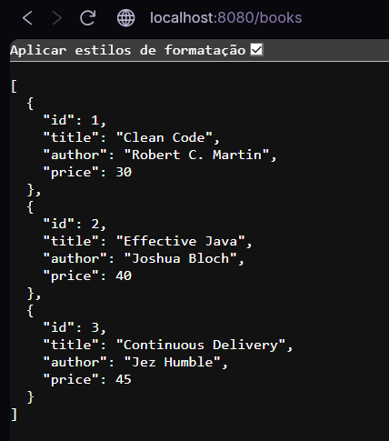
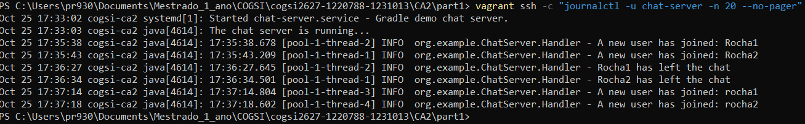

# CA2 - Virtualization

## Part 1 - Vagrant com uma Máquina Virtual

Este relatório técnico descreve a análise, configuração e execução dos requisitos da Parte 1 do CA2. O objetivo foi correr as duas aplicações do CA1 dentro de uma máquina virtual criada e provisionada com o Vagrant: a aplicação de chat (Gradle demo, `CA1/part1`) e a Bookstore em Spring Boot (`CA1/part2`). Em conformidade com o formato de tutorial exigido, documentam-se abaixo os passos, comandos e opções adotadas, bem como os problemas encontrados e a forma como foram resolvidos.

Todos os comandos do host foram executados em PowerShell, no Windows, a partir da pasta `CA2/part1`, exceto quando indicado.

### 1. Ambiente e Ferramentas

| Ferramenta | Versão | Papel |
|---|---|---|
| Windows (host) | Windows 11 26H2 | Sistema operativo da máquina física |
| Oracle VirtualBox | 7.2.18r175117 | Hipervisor (*provider*) que executa a VM |
| Vagrant | Vagrant 2.4.9 | Criação, configuração e provisionamento da VM |
| bento/ubuntu-24.04 | 202510.26.0 | Imagem base (*box*) da VM |

O VirtualBox 7.2 só é suportado a partir do Vagrant 2.4.9. Com versões anteriores do Vagrant, o *provider* `virtualbox` é rejeitado.

**Output dos comandos de verificação:**

    PS> vagrant --version
    Vagrant 2.4.9
    PS> & "C:\Program Files\Oracle\VirtualBox\VBoxManage.exe" --version
    7.2.18r175117

### 2. Arquitetura e Estrutura dos Ficheiros

A solução usa **uma única VM** (`cogsi-ca2`, IP privado `192.168.56.10`). A VM instala as dependências, clona o repositório do grupo, compila as duas aplicações e executa-as como serviços `systemd`:

    Host (Windows)                                   VM cogsi-ca2 (Ubuntu 24.04)
    ┌──────────────────────────────┐                ┌───────────────────────────────────────┐
    │ Browser ── localhost:8080 ───┼── port fwd ───►│ bookstore.service  (Spring Boot :8080)│
    │                              │                │        │                              │
    │ Cliente chat 1 ─┐            │                │        ▼ jdbc:h2:file                 │
    │ Cliente chat 2 ─┴─ 192.168.56.10:59001 ──────►│ chat-server.service (:59001)          │
    │                              │                │                                       │
    │ CA2/part1/h2-data/ ◄─────────┼── synced ──────┤ /home/vagrant/h2-data                 │
    │ CA2/part1/        ◄──────────┼── synced ──────┤ /vagrant                              │
    └──────────────────────────────┘                └───────────────────────────────────────┘

Foram versionados apenas os ficheiros necessários para reproduzir o trabalho:

    CA2/part1/
    ├── .gitattributes                 # Força finais de linha LF nos scripts e no Vagrantfile
    ├── Vagrantfile                    # Definição da VM e ordem do provisionamento
    ├── provision/
    │   ├── system.sh                  # Instala as dependências do sistema (root)
    │   ├── apps.sh                    # Clona o repositório e compila as aplicações (vagrant)
    │   └── start.sh                   # Instala e (re)inicia os serviços systemd (root, sempre)
    └── config/
        └── application.properties     # Configuração da Bookstore na VM (H2 em ficheiro)

### 3. Escolha e Fixação da Box

A box foi descarregada e a sua versão consultada com os seguintes comandos:

    vagrant box add bento/ubuntu-24.04 --provider virtualbox
    vagrant box list

**Output do comando `vagrant box list`:**

    bento/ubuntu-24.04 (virtualbox, 202510.26.0, (amd64))

**Justificação da confiança na origem da box:**

* As boxes `bento/*` são mantidas pelo projeto **Chef Bento**, da Progress Chef. São das boxes mais utilizadas no Vagrant Cloud e são a recomendação habitual da própria documentação do Vagrant.
* Os templates Packer que geram as boxes são públicos em `github.com/chef/bento`. O processo de construção pode, por isso, ser auditado: sabe-se exatamente que pacotes e configurações são incluídos. Uma box publicada por um utilizador anónimo é uma imagem opaca, sem garantias sobre o seu conteúdo.
* As boxes Bento trazem as **VirtualBox Guest Additions** instaladas, que são necessárias para as pastas sincronizadas (`vboxsf`) usadas na persistência do H2.
* O Ubuntu 24.04 é uma versão LTS, com atualizações de segurança até 2029.

**Justificação da fixação da versão:**

    config.vm.box              = "bento/ubuntu-24.04"
    config.vm.box_version      = "202510.26.0"
    config.vm.box_check_update = false

A fixação da `box_version` garante que todos os membros do grupo, e quem avaliar o trabalho, criam a VM a partir da mesma imagem, ou seja, que o ambiente é **reprodutível**. Sem esta linha, um `vagrant up` feito mais tarde podia usar uma versão mais recente da box, com outro kernel ou outros pacotes, e o comportamento podia mudar sem qualquer alteração no repositório. O `box_check_update = false` evita o aviso de "nova versão disponível" em cada arranque. A atualização da box passa a ser uma decisão explícita: alterar a versão no Vagrantfile e fazer commit.

### 4. Vagrantfile

    # -*- mode: ruby -*-
    # CA2 - Part 1: one VM that builds and runs the Gradle demo (chat) and the Bookstore

    BOX_NAME    = "bento/ubuntu-24.04"
    BOX_VERSION = "202510.26.0"   # versao mostrada por `vagrant box list`
    VM_IP       = "192.168.56.10"

    # Host environment variables decide which provisioning steps run
    def flag(name, default = "true")
      ENV.fetch(name, default).to_s.downcase
    end

    Vagrant.configure("2") do |config|
      config.vm.box              = BOX_NAME
      config.vm.box_version      = BOX_VERSION
      config.vm.box_check_update = false
      config.vm.hostname         = "cogsi-ca2"

      # Private network (chat clients) + forwarded ports (browser on localhost)
      config.vm.network "private_network", ip: VM_IP
      config.vm.network "forwarded_port", guest: 8080,  host: 8080,  host_ip: "127.0.0.1"
      config.vm.network "forwarded_port", guest: 59001, host: 59001, host_ip: "127.0.0.1"

      # Dedicated synced folder for the H2 database files
      config.vm.synced_folder "./h2-data", "/home/vagrant/h2-data",
        create: true, owner: "vagrant", group: "vagrant"
      config.vm.provider "virtualbox" do |vb|
        vb.name   = "cogsi-ca2-part1"
        vb.memory = 3072
        vb.cpus   = 2
      end

      env = {
        "CLONE_REPO"  => flag("CLONE_REPO"),
        "BUILD_APPS"  => flag("BUILD_APPS"),
        "START_APPS"  => flag("START_APPS"),
        "REPO_URL"    => ENV.fetch("REPO_URL", "https://github.com/Rochaprtisep/cogsi2627-1220788-1231013.git"),
        "REPO_BRANCH" => ENV.fetch("REPO_BRANCH", "main"),
      }

      config.vm.provision "system", type: "shell", path: "provision/system.sh"
      config.vm.provision "apps",   type: "shell", path: "provision/apps.sh",
        privileged: false, env: env
      config.vm.provision "start",  type: "shell", path: "provision/start.sh",
        run: "always", env: env
    end

**Opções adotadas:**

* **Rede privada (`192.168.56.10`):** dá à VM um IP fixo e acessível a partir do host, usado pelos clientes do chat. O intervalo `192.168.56.0/21` foi escolhido por ser o único que o VirtualBox (versão 6.1.28 ou superior) aceita por omissão para redes *host-only*.
* **Port forwarding da porta 8080:** permite abrir a Bookstore em `http://localhost:8080` no browser do host. A porta 59001 também foi reencaminhada, para que o chat possa ser usado via `localhost`. O `host_ip: "127.0.0.1"` faz com que as portas só fiquem acessíveis a partir do próprio host e não da rede onde o portátil está ligado (por exemplo, a rede do ISEP).
* **Recursos (3 GB de RAM, 2 CPUs):** durante o provisionamento correm ao mesmo tempo o Gradle (numa JVM própria), a compilação do Spring Boot com os testes de integração e, no fim, as duas aplicações. Com 1 GB, o valor por omissão, o build ficava muito lento ou falhava por falta de memória.
* **Três provisionadores com responsabilidades separadas:** cada um corre com o utilizador adequado e pode ser executado isoladamente com `vagrant provision --provision-with <nome>`:

| Provisionador | Script | Utilizador | Quando corre |
|---|---|---|---|
| `system` | `provision/system.sh` | root | No primeiro `vagrant up` e em cada `vagrant provision` |
| `apps` | `provision/apps.sh` | vagrant (`privileged: false`) | No primeiro `vagrant up` e em cada `vagrant provision` |
| `start` | `provision/start.sh` | root | Em **todos** os `vagrant up` e `vagrant reload` (`run: "always"`) |

### 5. Provisionamento das Dependências (`system.sh`)

    #!/usr/bin/env bash
    # Installs the system dependencies. Idempotent: only installs what is missing.
    set -euo pipefail
    export DEBIAN_FRONTEND=noninteractive

    PACKAGES="git curl unzip maven openjdk-17-jdk-headless openjdk-21-jdk-headless"

    missing=""
    for p in $PACKAGES; do
      dpkg -s "$p" >/dev/null 2>&1 || missing="$missing $p"
    done

    if [ -n "$missing" ]; then
      echo "[system] A instalar:$missing"
      apt-get update -qq
      apt-get install -y -qq $missing
    else
      echo "[system] Todos os pacotes ja estao instalados - nada a fazer"
    fi

    echo "[system] JDKs disponiveis:"; ls /usr/lib/jvm
    git --version
    mvn -v | head -1

**Opções adotadas:**

* **Dois JDKs (17 e 21):** a aplicação de chat usa uma *toolchain* Java 21 e a Bookstore uma *toolchain* Java 17. Com os dois JDKs instalados em `/usr/lib/jvm`, o Gradle deteta-os automaticamente e não precisa de os descarregar através do plugin foojay em cada VM nova.
* **Gradle não instalado como pacote:** os dois projetos usam o **Gradle Wrapper** (`gradlew`), que descarrega a versão exata definida em `gradle-wrapper.properties` (9.4.0). O pacote `gradle` dos repositórios do Ubuntu é a versão 4.4.1, demasiado antiga para estes projetos. Instalá-lo só criaria o risco de alguém usar a versão errada. É o mesmo argumento usado no CA1 a favor do Wrapper.
* **Maven:** foi instalado porque é referido no enunciado como dependência e porque a Bookstore original era um projeto Maven. Fica assim disponível para comparação.
* **Pacotes `-headless`:** a VM não tem interface gráfica, por isso não são instaladas as bibliotecas gráficas do JDK. Ver a secção 8 para as consequências.
* **Idempotência:** o script verifica com `dpkg -s` quais os pacotes que já estão instalados e só chama o `apt-get` para os que faltam. O `set -euo pipefail` interrompe o provisionamento ao primeiro erro, em vez de continuar num estado inconsistente.

**Output de uma segunda execução (`vagrant provision`), que comprova a idempotência:**

    ==> default: Running provisioner: system (shell)...
        default: [system] Todos os pacotes ja estao instalados - nada a fazer
        default: [system] JDKs disponiveis:
        default: default-java
        default: java-1.17.0-openjdk-amd64
        default: java-1.21.0-openjdk-amd64
        default: java-17-openjdk-amd64
        default: java-21-openjdk-amd64
        default: git version 2.43.0
        default: Apache Maven 3.8.7

### 6. Clonagem e Build das Aplicações (`apps.sh`)

    #!/usr/bin/env bash
    # Clones and builds both applications (runs as the vagrant user). Idempotent.
    set -euo pipefail

    CLONE_REPO="${CLONE_REPO:-true}"
    BUILD_APPS="${BUILD_APPS:-true}"
    REPO_BRANCH="${REPO_BRANCH:-main}"
    REPO_DIR="$HOME/cogsi"

    if [ "$CLONE_REPO" = "true" ]; then
      if [ -d "$REPO_DIR/.git" ]; then
        echo "[apps] Repositorio ja existe - a atualizar"
        git -C "$REPO_DIR" fetch --quiet origin
        git -C "$REPO_DIR" checkout --quiet "$REPO_BRANCH"
        git -C "$REPO_DIR" pull --ff-only --quiet origin "$REPO_BRANCH"
      else
        echo "[apps] A clonar o repositorio (branch $REPO_BRANCH)"
        git clone --quiet --branch "$REPO_BRANCH" "$REPO_URL" "$REPO_DIR"
      fi
    else
      echo "[apps] CLONE_REPO=false - clone ignorado"
    fi

    if [ "$BUILD_APPS" = "true" ]; then
      if [ ! -d "$REPO_DIR" ]; then
        echo "[apps] ERRO: $REPO_DIR nao existe. Corre com CLONE_REPO=true." >&2
        exit 1
      fi
      echo "[apps] Build do Gradle demo (chat)"
      (cd "$REPO_DIR/CA1/part1" && ./gradlew clean build packageApp --no-daemon --console=plain)
      echo "[apps] Build do Bookstore"
      (cd "$REPO_DIR/CA1/part2" && ./gradlew clean build --no-daemon --console=plain)
    else
      echo "[apps] BUILD_APPS=false - build ignorado"
    fi

**Opções adotadas:**

* **Clonar o repositório em vez de usar a pasta `/vagrant`:** o enunciado pede que o repositório seja clonado dentro da VM. Assim, a VM compila exatamente o que está no GitHub (branch `main`) e não o que está na pasta local do host, que pode ter alterações por fazer commit. É o comportamento que se teria num servidor real.
* **`privileged: false`:** o clone e o build correm como o utilizador `vagrant` e não como `root`. Os ficheiros do repositório e a cache `~/.gradle` ficam assim com o dono correto. O serviço também corre como `vagrant`, por isso não há problemas de permissões.
* **Idempotência:** se o repositório já existir, o script faz `fetch` e `pull --ff-only` em vez de `clone`, que falharia por a pasta já existir. O `--ff-only` garante que o script nunca cria commits de merge dentro da VM.
* **`--no-daemon`:** o Gradle não deixa um *daemon* em memória depois do provisionamento, libertando RAM para as aplicações.
* **`packageApp`:** é a tarefa criada no CA1 que copia as dependências do chat (log4j) para `build/libs/lib`, que é o que o servidor precisa para correr fora do Gradle.
* **`build` em vez de `assemble`:** o build corre também os testes unitários e de integração. Um commit que parta os testes não chega a ser posto em execução na VM.

**Alterações necessárias ao CA1:** para as aplicações correrem na VM, foram feitas duas alterações ao código do CA1, cada uma na sua branch:

1. **`gradlew` sem permissão de execução** (branch `ca2-part1-fix-gradlew`). Os scripts tinham sido criados em Windows e estavam guardados no Git com o modo `100644`. Ver a secção 11.1.
**Output do provisionamento `apps` (excerto):**

    ==> default: Running provisioner: apps (shell)...
        default: [apps] Repositorio ja existe - a atualizar
        default: [apps] Build do Gradle demo (chat)
        default: Reusing configuration cache.
        default: > Task :app:clean
        default: > Task :app:copyDependencies
        default: > Task :app:compileJava
        default: > Task :app:jar
        default: Generated application JAR: chat-server-1.0.jar
        default: > Task :app:packageApp
        default: > Task :app:test
        default: AppTest > greetingIsNotNull() PASSED
        default: AppTest > greetingMentionsTheApplicationName() PASSED
        default: > Task :app:build
        default: BUILD SUCCESSFUL in 15s
        default: 10 actionable tasks: 10 executed
        default: [apps] Build do Bookstore
        default: > Task :app:clean
        default: > Task :app:compileJava
        default: > Task :app:bootJar
        default: > Task :app:test
        default: > Task :app:integrationTest
        default: > Task :app:check
        default: > Task :app:build
        default: BUILD SUCCESSFUL in 31s
        default: 16 actionable tasks: 16 executed
        default: Configuration cache entry reused.

A mensagem `To honour the JVM settings for this build a single-use Daemon process will be forked` que aparece antes de cada build não é um erro. Com `--no-daemon`, o Gradle lança um *daemon* só para esse build, porque o projeto define opções próprias para a JVM, e termina-o no fim.

### 7. Arranque das Aplicações como Serviços (`start.sh`)

    #!/usr/bin/env bash
    # Installs the built artifacts as systemd services and (re)starts them.
    # Runs on every `vagrant up`/`reload`, after Vagrant has mounted the synced folders.
    set -euo pipefail

    if [ "${START_APPS:-true}" != "true" ]; then
      echo "[start] START_APPS=false - servicos nao arrancados"
      exit 0
    fi

    REPO_DIR=/home/vagrant/cogsi
    CHAT_LIBS="$REPO_DIR/CA1/part1/app/build/libs"
    BOOK_LIBS="$REPO_DIR/CA1/part2/app/build/libs"

    if [ ! -d "$CHAT_LIBS" ] || [ ! -d "$BOOK_LIBS" ]; then
      echo "[start] ERRO: aplicacoes ainda nao compiladas. Corre com BUILD_APPS=true." >&2
      exit 1
    fi

    # --- Copy artifacts to /opt (the services never run from the git working copy) ---
    install -d -o vagrant -g vagrant /opt/chat /opt/bookstore
    rm -rf /opt/chat/*.jar /opt/chat/lib
    cp "$CHAT_LIBS"/chat-server-*.jar /opt/chat/
    cp -r "$CHAT_LIBS/lib" /opt/chat/lib
    BOOT_JAR=$(ls "$BOOK_LIBS"/bookstore-*.jar | grep -v -- '-plain' | head -1)
    cp "$BOOT_JAR" /opt/bookstore/bookstore.jar

    # --- H2 persistence: external config pointing to the synced folder ---
    cp /vagrant/config/application.properties /opt/bookstore/application.properties

    # --- systemd units ---
    cat > /etc/systemd/system/chat-server.service <<'UNIT'
    [Unit]
    Description=Gradle demo chat server
    After=network.target

    [Service]
    User=vagrant
    WorkingDirectory=/opt/chat
    ExecStart=/usr/bin/java -cp "/opt/chat/*:/opt/chat/lib/*" org.example.ChatServerApp 59001
    Restart=on-failure

    [Install]
    WantedBy=multi-user.target
    UNIT

    cat > /etc/systemd/system/bookstore.service <<'UNIT'
    [Unit]
    Description=Bookstore Spring Boot application
    After=network.target
    ConditionPathIsMountPoint=/home/vagrant/h2-data

    [Service]
    User=vagrant
    WorkingDirectory=/opt/bookstore
    ExecStart=/usr/bin/java -jar /opt/bookstore/bookstore.jar
    SuccessExitStatus=143
    Restart=on-failure

    [Install]
    WantedBy=multi-user.target
    UNIT

    systemctl daemon-reload
    systemctl restart chat-server bookstore

    # --- Wait until the Bookstore answers ---
    echo "[start] A aguardar pelo Bookstore..."
    for i in $(seq 1 60); do
      if curl -fs http://localhost:8080/actuator/health >/dev/null; then
        echo "[start] Bookstore UP em http://localhost:8080 (${i}s)"
        break
      fi
      sleep 1
    done
    curl -fs http://localhost:8080/actuator/health >/dev/null || { echo "[start] Bookstore nao arrancou: journalctl -u bookstore" >&2; exit 1; }
    systemctl is-active --quiet chat-server && echo "[start] Chat server UP na porta 59001"

**Opções adotadas:**

* **Serviços `systemd` em vez de `./gradlew bootRun &`:** um processo em primeiro plano bloquearia o `vagrant up` indefinidamente, porque um servidor nunca termina. Um processo em segundo plano (`&`) é terminado quando a sessão SSH do provisionamento fecha. Com o `systemd`, as aplicações ficam desacopladas do provisionamento e ganham logs centralizados (`journalctl -u <serviço>`), reinício automático em caso de falha (`Restart=on-failure`) e um `systemctl restart` que é idempotente.
* **Executar o JAR em vez do `bootRun`:** o `bootJar` é o artefacto que seria entregue num deployment real. Arranca em segundos e não precisa de uma JVM do Gradle a correr por cima da aplicação. O *plain JAR* (`-plain`) é excluído porque não contém as dependências.
* **Cópia dos artefactos para `/opt`:** os serviços nunca correm a partir da cópia de trabalho do Git. Um `./gradlew clean` posterior não apaga o JAR que está em execução.
* **`run: "always"` em vez de `systemctl enable`:** o Vagrant só monta as pastas sincronizadas **depois** de o sistema operativo da VM arrancar. Se o serviço da Bookstore arrancasse sozinho no boot, o H2 escreveria na pasta local `/home/vagrant/h2-data` antes de a pasta sincronizada ser montada por cima, e os dados pareceriam perdidos. Um provisionador `always` corre em cada `up`/`reload`, já com as pastas montadas.
* **`ConditionPathIsMountPoint`:** é uma salvaguarda adicional. Se a pasta sincronizada não estiver montada, o `systemd` não arranca a Bookstore, em vez de criar uma base de dados vazia no sítio errado.
* **`SuccessExitStatus=143`:** quando o `systemd` para a aplicação com `SIGTERM`, a JVM termina com o código 143. Esta linha indica que isso é uma paragem normal e não uma falha.
* **Health check:** o script espera até 60 segundos que o endpoint `/actuator/health` responda e falha se isso não acontecer. Uma aplicação que não arranca faz o provisionamento falhar, em vez de passar despercebida.

**Output do provisionamento `start`:**

    ==> default: Running provisioner: start (shell)...
        default: [start] A aguardar pelo Bookstore...
        default: [start] Bookstore UP em http://localhost:8080 ([N]s)
        default: [start] Chat server UP na porta 59001

[COLAR OUTPUT REAL, se for diferente]

### 8. Interação com as Aplicações a partir do Host

#### 8.1 Bookstore

Com o port forwarding da porta 8080, a API é acedida no browser do host em:

* `http://localhost:8080/` - raiz da API, com os links HATEOAS
* `http://localhost:8080/books`, `/clients`, `/orders`
* `http://localhost:8080/info`
* `http://localhost:8080/h2-console` - consola da base de dados (secção 10)

#### 8.2 Chat: servidor na VM, clientes no host

O servidor do chat corre na VM como serviço `chat-server`, na porta 59001. Os clientes são lançados no host com a tarefa `runClient` do CA1, apontando para o IP privado da VM:

    cd CA1\part1
    .\gradlew runClient -PserverIP=192.168.56.10 -PserverPort=59001

Foram abertos dois clientes em terminais diferentes, com nomes distintos, e as mensagens foram trocadas entre ambos.

#### 8.3 O cliente do chat não executa na VM

O enunciado avisa que algumas funcionalidades do Gradle demo não executam na VM por esta não ter interface gráfica. Para o confirmar, tentou-se lançar o cliente dentro da VM:

**Output do comando `vagrant ssh -c "cd ~/cogsi/CA1/part1 && ./gradlew runClient --no-daemon"`:**

    > Task :app:runClient FAILED
    Starting ChatClientApp with server IP: localhost and port: 59001
    Exception in thread "main" java.awt.HeadlessException:
    No X11 DISPLAY variable was set,
    or no headful library support was found,
    but this program performed an operation which requires it.
            at java.desktop/java.awt.GraphicsEnvironment.checkHeadless(GraphicsEnvironment.java:164)
            at java.desktop/java.awt.Window.<init>(Window.java:553)
            at java.desktop/java.awt.Frame.<init>(Frame.java:428)
            at java.desktop/javax.swing.JFrame.<init>(JFrame.java:224)
            at org.example.ChatClient.<init>(ChatClient.java:36)
            at org.example.ChatClientApp.main(ChatClientApp.java:29)

    FAILURE: Build failed with an exception.

    * What went wrong:
    Execution failed for task ':app:runClient'.
    > Process 'command '/usr/lib/jvm/java-21-openjdk-amd64/bin/java'' finished with non-zero exit value 1

**Explicação:** o `ChatClient` é uma interface gráfica em Swing: cria um `JFrame` na linha 36. Quando o Swing tenta abrir uma janela, o Java verifica se existe um ambiente gráfico. Na VM essa verificação falha por três razões:

1. não existe um servidor gráfico (X11 ou Wayland) a correr;
2. a variável `DISPLAY` não está definida na sessão SSH;
3. o JDK instalado é a variante *headless*, sem as bibliotecas gráficas nativas.

Por isso é lançada a `java.awt.HeadlessException`. O servidor (`ChatServerApp`) não usa nenhuma classe gráfica e corre sem problemas. É por isso que a arquitetura adotada coloca o servidor na VM e os clientes no host, que é também a divisão pedida no enunciado.

**Alternativa considerada e não adotada:** instalar o JDK completo na VM e um servidor X no Windows (por exemplo, o VcXsrv), e ligar com `vagrant ssh -- -X` para reencaminhar as janelas para o host. Esta solução acrescenta dependências ao host e contraria o objetivo de uma VM de servidor sem interface gráfica.

### 9. Variáveis de Ambiente no Provisionamento

O Vagrantfile lê variáveis de ambiente do host (`ENV.fetch`) no momento em que é carregado e passa-as aos scripts através da opção `env:` de cada provisionador. Assim é possível escolher que passos são executados, sem alterar nenhum ficheiro:

| Variável | Valor por omissão | Efeito quando é `false` |
|---|---|---|
| `CLONE_REPO` | `true` | Não clona nem atualiza o repositório |
| `BUILD_APPS` | `true` | Não compila as aplicações |
| `START_APPS` | `true` | Não instala nem (re)inicia os serviços |
| `REPO_URL` | URL do repositório do grupo | Permite usar outro repositório, ou um URL com token se o repositório for privado |
| `REPO_BRANCH` | `main` | Permite testar outra branch na VM |

Os valores por omissão correspondem ao comportamento completo, pelo que um `vagrant up` sem variáveis prepara tudo.

Em PowerShell, as variáveis definidas com `$env:` ficam ativas até a janela ser fechada. Por isso devem ser removidas no fim de cada teste:

**Arrancar os serviços sem clonar nem compilar:**

    $env:CLONE_REPO="false"; $env:BUILD_APPS="false"
    vagrant provision
    Remove-Item Env:CLONE_REPO, Env:BUILD_APPS

    ==> default: Running provisioner: apps (shell)...
        default: [apps] CLONE_REPO=false - clone ignorado
        default: [apps] BUILD_APPS=false - build ignorado
    ==> default: Running provisioner: start (shell)...
        default: [start] Bookstore UP em http://localhost:8080 ([N]s)
        default: [start] Chat server UP na porta 59001

[COLAR OUTPUT REAL]

**Atualizar e compilar sem arrancar os serviços:**

    $env:START_APPS="false"
    vagrant provision
    Remove-Item Env:START_APPS

    ==> default: Running provisioner: apps (shell)...
        default: [apps] Repositorio ja existe - a atualizar
        default: [apps] Build do Gradle demo (chat)
        ...
        default: [apps] Build do Bookstore
        ...
    ==> default: Running provisioner: start (shell)...
        default: [start] START_APPS=false - servicos nao arrancados

**Idempotência completa:** a execução de `vagrant provision` duas vezes seguidas, sem variáveis, termina sem erros. Na segunda execução, o `system.sh` não instala nada (`Todos os pacotes ja estao instalados`), o `apps.sh` atualiza em vez de clonar (`Repositorio ja existe - a atualizar`) e o `start.sh` reinicia os serviços com `systemctl restart`, que pode ser executado qualquer número de vezes.

### 10. Reprodução do Trabalho

Para reproduzir a Parte 1 numa máquina com o VirtualBox e o Vagrant instalados:

    git clone https://github.com/Rochaprtisep/cogsi2627-1220788-1231013.git
    cd cogsi2627-1220788-1231013\CA2\part1
    vagrant up

No fim do `vagrant up`:

* a Bookstore está disponível em `http://localhost:8080`;
* os clientes do chat ligam-se com `.\gradlew runClient -PserverIP=192.168.56.10 -PserverPort=59001`, a partir de `CA1\part1`.

Outros comandos úteis:

| Comando | Efeito |
|---|---|
| `vagrant provision` | Volta a executar o provisionamento (idempotente) |
| `vagrant reload` | Reinicia a VM; os serviços são reiniciados pelo provisionador `start` |
| `vagrant halt` / `vagrant up` | Desliga e volta a ligar a VM |
| `vagrant destroy -f` | Apaga a VM; os dados do H2 mantêm-se em `h2-data` |
| `vagrant ssh -c "journalctl -u bookstore -n 50 --no-pager"` | Consulta os logs da Bookstore |

**Reflexão Prática:**
A Parte 1 mostrou que o Vagrant torna o ambiente de execução tão reprodutível como o código: com o Vagrantfile, os scripts de provisionamento e uma box com versão fixada, qualquer membro do grupo obtém a mesma VM com um único `vagrant up`. A exigência de idempotência obrigou a pensar cada passo como "garantir um estado" e não como "executar uma ação": instalar só o que falta, atualizar em vez de clonar, reiniciar em vez de arrancar.

As principais dificuldades não vieram do Vagrant em si, mas da interação com o host. O conflito entre o VirtualBox e o Hyper-V do Windows, as permissões de ficheiros criados em Windows e os finais de linha CRLF mostram que a virtualização não elimina por completo as diferenças entre sistemas operativos. Obriga, sim, a torná-las explícitas na configuração. Também se percebeu a importância da ordem de arranque: o facto de as pastas sincronizadas só serem montadas depois do boot levou a usar um provisionador `always` em vez de ativar os serviços no arranque do sistema.

## Autoavaliação

| Membro | Contribuição |
|---|---|
| 1220788 - Pedro Rocha | 50% |
| 1231013 - Tiago Fontes | 50% |