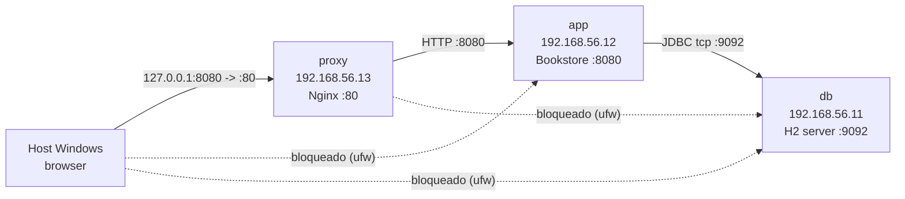
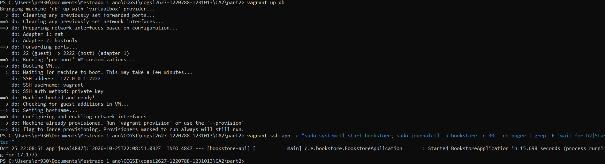
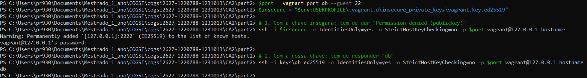
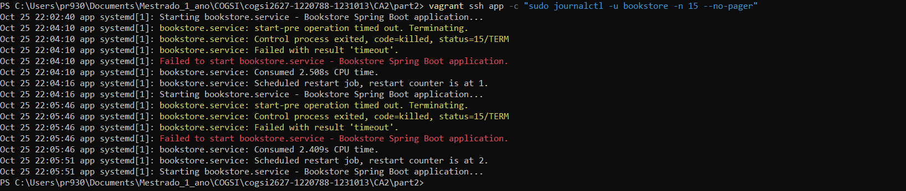
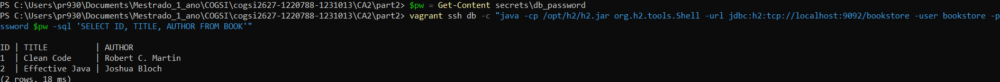
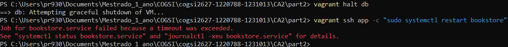
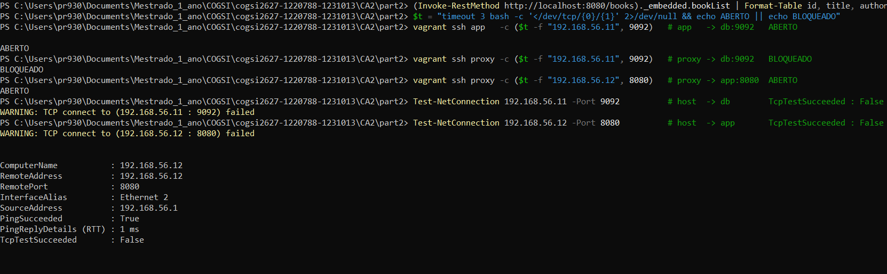

# CA2 - Virtualization

## Part 2 - Vagrant com Três Máquinas Virtuais (db, app e proxy)

Este relatório técnico descreve a análise, configuração e execução dos requisitos da Parte 2 do CA2. O objetivo foi usar o Vagrant para montar um ambiente com várias VMs que executa a versão Gradle da Bookstore em Spring Boot (`CA1/part2`), com a base de dados H2 isolada numa VM própria e acedida pela rede privada. Para aproximar o ambiente de um cenário real, foi também acrescentada uma terceira VM com o Nginx como *reverse proxy*, que passa a ser a única porta de entrada a partir do host.

Em conformidade com o formato de tutorial exigido, documentam-se abaixo os passos, comandos e opções adotadas, bem como os problemas encontrados e a forma como foram resolvidos. Todos os comandos do host foram executados em PowerShell, no Windows, a partir da pasta `CA2/part2`, exceto quando indicado.

### 1. Ambiente e Ferramentas

| Ferramenta | Versão | Papel |
|---|---|---|
| Windows (host) | Windows 11 26H2 | Sistema operativo da máquina física |
| Oracle VirtualBox | 7.2.18r175117 | Hipervisor (*provider*) que executa as VMs |
| Vagrant | 2.4.9 | Criação, configuração e provisionamento das VMs |
| bento/ubuntu-24.04 | 202510.26.0 | Imagem base (*box*) das três VMs |
| H2 Database | 2.3.232 | Motor de base de dados, em modo servidor na VM `db` |
| Nginx | versão do Ubuntu 24.04 | *Reverse proxy* na VM `proxy` |

A box e a sua versão são as mesmas da Parte 1. A justificação da confiança na origem (projeto Chef Bento, templates Packer públicos, Guest Additions incluídas, Ubuntu LTS) mantém-se e está descrita na secção 3 do relatório da Parte 1.

O valor é definido uma só vez no Vagrantfile (`H2_VERSION`) e pode ser alterado sem mexer nos scripts.

### 2. Arquitetura e Topologia de Rede

A solução usa **três VMs** ligadas à mesma rede privada *host-only* do VirtualBox (`192.168.56.0/24`). Cada VM tem um papel único:

| VM | Hostname / IP | Recursos | O que executa | Quem pode entrar |
|---|---|---|---|---|
| `db` | `db` / `192.168.56.11` | 1 CPU, 1 GB | H2 em modo servidor (TCP `9092`), utilizador de sistema `h2` | porta `9092` **só** a partir da `app`; SSH |
| `app` | `app` / `192.168.56.12` | 2 CPU, 2 GB | Bookstore (`8080`), utilizador de sistema `bookstore` | porta `8080` **só** a partir da `proxy`; SSH |
| `proxy` | `proxy` / `192.168.56.13` | 1 CPU, 512 MB | Nginx (`80`) | qualquer origem; o host entra por `localhost:8080` |



O mesmo esquema em texto, para quem lê o ficheiro fora do GitHub:

    Host (Windows)
      browser -> http://localhost:8080 --(port forwarding 127.0.0.1:8080 -> 80)--> proxy (Nginx :80)
                                                                                    |  HTTP :8080, rede privada
                                                                                    v
                                                                                   app   (Bookstore :8080)
                                                                                    |  JDBC tcp :9092, rede privada
                                                                                    v
                                                                                   db    (H2 server :9092, /srv/h2)

**Comunicações permitidas entre máquinas** (verificadas na secção 6.3):

| Origem | Destino | Porta | Resultado | Regra responsável |
|---|---|---|---|---|
| host | `proxy` | `80` (via `localhost:8080`) | permitido | port forwarding do Vagrant |
| `proxy` | `app` | `8080` | permitido | `ufw` da `app`: `allow from 192.168.56.13` |
| `app` | `db` | `9092` | permitido | `ufw` da `db`: `allow from 192.168.56.12` |
| `proxy` | `db` | `9092` | **bloqueado** | `ufw` da `db`: `default deny incoming` |
| host | `app` | `8080` | **bloqueado** | `ufw` da `app`: `default deny incoming` |
| host | `db` | `9092` | **bloqueado** | `ufw` da `db`: `default deny incoming` |
| host | todas | `22` (SSH) | permitido | necessário para o Vagrant |

Foram versionados apenas os ficheiros necessários para reproduzir o trabalho:

    CA2/part2/
    ├── .gitattributes                  # Força finais de linha LF nos scripts, configs e Vagrantfile
    ├── .gitignore                      # Exclui .vagrant/, keys/ e secrets/
    ├── Vagrantfile                     # Definição das três VMs, chaves SSH e ordem do provisionamento
    ├── config/
    │   ├── application.properties      # Configuração da Bookstore na VM app (H2 remoto, sem segredos)
    │   └── nginx/
    │       └── bookstore.conf          # Site do Nginx (reverse proxy para a app)
    ├── provision/
    │   ├── db.sh                       # VM db: H2 em modo servidor, conta de serviço e ufw
    │   ├── app-setup.sh                # VM app: pacotes e ufw (root)
    │   ├── app-build.sh                # VM app: clone e build do Bookstore (vagrant)
    │   ├── app-deploy.sh               # VM app: serviço systemd e health checks (root)
    │   ├── wait-for-h2.sh              # Health check da porta TCP do H2
    │   └── proxy.sh                    # VM proxy: Nginx
    └── images/                         # Screenshots deste relatório

As pastas `keys/` (chaves SSH privadas) e `secrets/` (password da base de dados) são geradas no PC de cada membro pelo próprio Vagrantfile e **nunca** são enviadas para o Git.

**Porque é que a base de dados já não está numa pasta sincronizada, como na Parte 1?** Nesta parte o objetivo é isolar a `db`. Os dados ficam no disco da própria VM, em `/srv/h2`, acessíveis apenas ao utilizador `h2`. Sobrevivem a `vagrant reload` e a `vagrant halt`/`up`; só um `vagrant destroy db` os apaga. As pastas partilhadas do VirtualBox (`vboxsf`) ignoram `chmod` e `chown`, por isso não seria possível restringir o acesso aos ficheiros da base de dados se estes estivessem numa pasta sincronizada.

### 3. Vagrantfile Multi-Máquina

```ruby
# -*- mode: ruby -*-
# CA2 - Part 2: Bookstore on three VMs
#   db    -> H2 in server (TCP) mode
#   app   -> Spring Boot (Bookstore), JDBC client of the db VM
#   proxy -> Nginx reverse proxy, the only entry point from the host
require "fileutils"
require "securerandom"

BOX_NAME    = "bento/ubuntu-24.04"
BOX_VERSION = "202510.26.0"   # same pinned version as Part 1

DB_IP    = "192.168.56.11"
APP_IP   = "192.168.56.12"
PROXY_IP = "192.168.56.13"

H2_PORT    = "9092"
H2_VERSION = ENV.fetch("H2_VERSION", "2.3.232")   # must match the H2 driver used by the Bookstore
DB_USER    = ENV.fetch("DB_USER", "bookstore")

ROOT        = File.dirname(File.expand_path(__FILE__))
KEYS_DIR    = File.join(ROOT, "keys")
SECRETS_DIR = File.join(ROOT, "secrets")

# Host environment variables decide which provisioning steps run
def flag(name, default = "true")
  ENV.fetch(name, default).to_s.downcase
end

# --- Generated once on the host and never committed (see .gitignore) ---
FileUtils.mkdir_p([KEYS_DIR, SECRETS_DIR])
%w[db app proxy].each do |name|
  key = File.join(KEYS_DIR, "#{name}_ed25519")
  next if File.exist?(key)
  system("ssh-keygen", "-q", "-t", "ed25519", "-N", "", "-C", "cogsi-ca2-#{name}", "-f", key) ||
    abort("[Vagrantfile] ssh-keygen falhou para '#{name}'. Gera a chave a mao (guiao, passo 1.5).")
end
pw_file = File.join(SECRETS_DIR, "db_password")
File.write(pw_file, SecureRandom.alphanumeric(24)) unless File.exist?(pw_file)
DB_PASSWORD = ENV.fetch("DB_PASSWORD", File.read(pw_file).strip)

# Vagrant's public "insecure" keys. Only needed on the very first boot, before our key is installed.
INSECURE_KEYS = Dir.glob(File.join(Vagrant.user_data_path.to_s, "insecure_private_key{,s/*}"))
                   .reject { |f| f.end_with?(".pub") }
warn "[Vagrantfile] Chaves 'insecure' do Vagrant nao encontradas: VMs novas nao vao aceitar SSH." if INSECURE_KEYS.empty?

# Each VM trusts only its own key: the first provisioner replaces authorized_keys
def custom_ssh(node, name)
  node.ssh.insert_key       = false
  node.ssh.private_key_path = [File.join(KEYS_DIR, "#{name}_ed25519")] + INSECURE_KEYS
  node.vm.provision "ssh-key", type: "file",
    source: File.join(KEYS_DIR, "#{name}_ed25519.pub"),
    destination: "/home/vagrant/.ssh/authorized_keys"
end

Vagrant.configure("2") do |config|
  config.vm.box              = BOX_NAME
  config.vm.box_version      = BOX_VERSION
  config.vm.box_check_update = false

  # ---------------------------------------------------------------- db
  config.vm.define "db" do |db|
    db.vm.hostname = "db"
    db.vm.network "private_network", ip: DB_IP
    db.vm.synced_folder ".", "/vagrant", disabled: true   # isolated: does not see the project files
    db.vm.provider "virtualbox" do |vb|
      vb.name   = "cogsi-ca2-db"
      vb.memory = 1024
      vb.cpus   = 1
    end
    custom_ssh(db, "db")
    db.vm.provision "db", type: "shell", path: "provision/db.sh", env: {
      "H2_VERSION"  => H2_VERSION,
      "H2_PORT"     => H2_PORT,
      "DB_USER"     => DB_USER,
      "DB_PASSWORD" => DB_PASSWORD,
      "APP_IP"      => APP_IP,
    }
  end

  # ---------------------------------------------------------------- app
  config.vm.define "app" do |app|
    app.vm.hostname = "app"
    app.vm.network "private_network", ip: APP_IP
    app.vm.provider "virtualbox" do |vb|
      vb.name   = "cogsi-ca2-app"
      vb.memory = 2048
      vb.cpus   = 2
    end
    custom_ssh(app, "app")
    app.vm.provision "app-setup", type: "shell", path: "provision/app-setup.sh", env: {
      "PROXY_IP" => PROXY_IP,
    }
    app.vm.provision "app-build", type: "shell", path: "provision/app-build.sh", privileged: false, env: {
      "CLONE_REPO"  => flag("CLONE_REPO"),
      "BUILD_APPS"  => flag("BUILD_APPS"),
      "REPO_URL"    => ENV.fetch("REPO_URL", "https://github.com/Rochaprtisep/cogsi2627-1220788-1231013.git"),
      "REPO_BRANCH" => ENV.fetch("REPO_BRANCH", "main"),
    }
    app.vm.provision "app-deploy", type: "shell", path: "provision/app-deploy.sh", env: {
      "START_APPS"  => flag("START_APPS"),
      "DB_IP"       => DB_IP,
      "H2_PORT"     => H2_PORT,
      "DB_USER"     => DB_USER,
      "DB_PASSWORD" => DB_PASSWORD,
    }
  end

  # ---------------------------------------------------------------- proxy
  config.vm.define "proxy" do |proxy|
    proxy.vm.hostname = "proxy"
    proxy.vm.network "private_network", ip: PROXY_IP
    proxy.vm.network "forwarded_port", guest: 80, host: 8080, host_ip: "127.0.0.1"
    proxy.vm.provider "virtualbox" do |vb|
      vb.name   = "cogsi-ca2-proxy"
      vb.memory = 512
      vb.cpus   = 1
    end
    custom_ssh(proxy, "proxy")
    proxy.vm.provision "proxy", type: "shell", path: "provision/proxy.sh", env: {
      "APP_IP" => APP_IP,
    }
  end
end
```

**Opções adotadas:**

* **Um bloco `config.vm.define` por VM.** Cada máquina tem hostname, IP, recursos e provisionadores próprios. A box e a sua versão são definidas uma vez, no nível global, e partilhadas pelas três. Cada VM pode ser gerida isoladamente: `vagrant up db`, `vagrant provision app`, `vagrant ssh proxy`.
* **Ordem de definição = ordem de arranque.** O `vagrant up` cria primeiro a `db`, depois a `app` e por fim a `proxy`. É a ordem das dependências: a `app` precisa da base de dados para arrancar, e a `proxy` precisa da `app` para o seu health check passar.
* **IPs fixos na rede `192.168.56.0/24`.** É a rede *host-only* que o VirtualBox 7 aceita por omissão. Os IPs são fixos porque as regras do `ufw` e o *upstream* do Nginx identificam as máquinas pelo endereço. Ficam a seguir ao `192.168.56.10` da Parte 1, para não haver conflito se as duas VMs coexistirem.
* **Constantes num só sítio.** Os IPs, a porta e a versão do H2 e as credenciais estão definidos no topo do Vagrantfile e são passados aos scripts pela opção `env:`. Os scripts não têm nenhum endereço escrito à mão.
* **A `db` não monta a pasta do projeto** (`synced_folder ".", "/vagrant", disabled: true`). O provisionador `shell` do Vagrant envia o script por SSH, por isso a `db` não precisa de nenhum ficheiro do repositório. A VM que guarda os dados não tem acesso ao código nem às chaves privadas que estão em `CA2/part2/keys`.
* **Só a `proxy` tem port forwarding**, e apenas em `127.0.0.1`. É a única porta de entrada a partir do host, e não fica exposta à rede onde o portátil está ligado.

#### 3.1 Recursos (CPU, memória e disco)

| VM | CPU | RAM | Justificação |
|---|---|---|---|
| `app` | 2 | 2 GB | É a VM mais exigente: o build com o Gradle Wrapper corre numa JVM própria, com os testes unitários e de integração numa segunda JVM, e no fim arranca o Spring Boot (`-Xmx768m`). |
| `db` | 1 | 1 GB | O H2 corre com `-Xmx512m`; o resto chega para o sistema operativo. |
| `proxy` | 1 | 512 MB | O Nginx usa poucos MB; não há nenhuma JVM nesta VM. |

No total são 3,5 GB, pouco mais do que os 3 GB da VM única da Parte 1, mas agora repartidos de forma a poder medir separadamente o consumo da aplicação e da base de dados, como sugere o enunciado. **Disco:** a box bento usa um disco virtual de alocação dinâmica, que só ocupa espaço no host à medida que é usado.

Os recursos efetivos de cada VM foram confirmados com:

```powershell
vagrant ssh app -c "nproc; free -h; df -h /"
vagrant ssh db  -c "nproc; free -h; df -h /"
```
### 4. Chaves SSH Próprias para Cada VM

Por omissão, o Vagrant entra numa VM nova com a chave "insecure", que é **pública** e igual em todas as instalações do Vagrant no mundo, e depois troca-a por uma chave aleatória gerada por ele. O enunciado pede que cada VM use chaves próprias, geradas e controladas pelo grupo.

A solução tem três partes, todas no Vagrantfile:

1. **Geração das chaves no host.** No primeiro `vagrant up`, o Vagrantfile corre o `ssh-keygen` e cria um par de chaves **Ed25519** por VM (`keys/db_ed25519`, `keys/app_ed25519`, `keys/proxy_ed25519`), cada uma com um comentário que identifica a VM (`cogsi-ca2-<vm>`). Se as chaves já existirem, não faz nada. A passphrase fica vazia (`-N ""`) porque o Vagrant tem de entrar sem interação. Foi escolhido Ed25519 por ser o algoritmo recomendado atualmente pelo OpenSSH: chaves curtas, assinatura rápida e maior segurança do que RSA com tamanhos antigos.
2. **`insert_key = false`.** Impede o Vagrant de gerar e instalar a sua própria chave aleatória. Quem decide a chave somos nós.
3. **Provisionador `ssh-key` (tipo `file`).** É o primeiro provisionador de cada VM e **substitui** o ficheiro `authorized_keys` do utilizador `vagrant` pela chave pública dessa VM. Ao substituir o ficheiro, a chave insegura é removida.

A lista `private_key_path` tem primeiro a chave própria e depois as chaves inseguras. As inseguras só são usadas na primeira ligação a uma VM acabada de criar, antes de o provisionador `ssh-key` correr; a partir daí a VM recusa-as e o Vagrant passa a entrar com a chave própria. O `Dir.glob` cobre os dois locais onde o Vagrant guarda as chaves inseguras: o antigo `~/.vagrant.d/insecure_private_key` e o novo `~/.vagrant.d/insecure_private_keys/` (Ed25519 e RSA), introduzido no Vagrant 2.4.

**Verificação da configuração:**

```powershell
vagrant status
dir keys, secrets
vagrant ssh-config db
vagrant ssh db -c "cat ~/.ssh/authorized_keys"
```

**Prova de que a chave insegura deixou de entrar:**

```powershell
$port = vagrant port db --guest 22
$insecure = "$env:USERPROFILE\.vagrant.d\insecure_private_keys\vagrant.key.ed25519"

# 1. Com a chave insegura do Vagrant
ssh -i $insecure -o IdentitiesOnly=yes -o StrictHostKeyChecking=no -p $port vagrant@127.0.0.1 hostname

# 2. Com a chave própria da VM db
ssh -i keys\db_ed25519 -o IdentitiesOnly=yes -o StrictHostKeyChecking=no -p $port vagrant@127.0.0.1 hostname
```



Com a chave insegura, o servidor SSH da VM **recusa a autenticação por chave** e passa ao método seguinte, pedindo a password (`vagrant@127.0.0.1's password:`); o pedido foi cancelado sem introduzir nada. Com a chave própria, a ligação é aceite e o comando `hostname` responde `db`.

**Observação:** o pedido de password mostra que a box bento mantém a autenticação por password ativa no `sshd` (com a password conhecida `vagrant`). A chave insegura já não dá acesso, que é o que o enunciado pede, mas num ambiente real a autenticação por password também deveria ser desativada (por exemplo, com um ficheiro `/etc/ssh/sshd_config.d/10-no-password.conf` com `PasswordAuthentication no`). Esta melhoria fica identificada na secção 12.

### 5. VM `db`: H2 em Modo Servidor

Por omissão, o Spring Boot usa um H2 **embebido** e em memória, dentro do próprio processo da aplicação, com o utilizador `sa` e password vazia. Em **modo servidor**, o H2 corre num processo separado (`org.h2.tools.Server -tcp`) e a aplicação liga-se como cliente JDBC, pela rede: `jdbc:h2:tcp://192.168.56.11:9092/bookstore`.

`provision/db.sh`:

```bash
#!/usr/bin/env bash
# db VM: H2 in server (TCP) mode as a systemd service, protected by ufw. Idempotent.
set -euo pipefail
export DEBIAN_FRONTEND=noninteractive

: "${H2_VERSION:?}" "${H2_PORT:?}" "${DB_USER:?}" "${DB_PASSWORD:?}" "${APP_IP:?}"
DB_NAME=bookstore
H2_DIR=/opt/h2
DATA_DIR=/srv/h2
H2_JAR="$H2_DIR/h2-$H2_VERSION.jar"
H2_URL="https://repo1.maven.org/maven2/com/h2database/h2/$H2_VERSION/h2-$H2_VERSION.jar"
H2_RUN="java -cp $H2_DIR/h2.jar"

# --- 1. Packages (only a JRE: the db VM never compiles anything) ---
missing=""
for p in openjdk-17-jre-headless curl ufw; do
  dpkg -s "$p" >/dev/null 2>&1 || missing="$missing $p"
done
if [ -n "$missing" ]; then
  echo "[db] A instalar:$missing"
  apt-get update -qq
  apt-get install -y -qq $missing
else
  echo "[db] Todos os pacotes ja estao instalados - nada a fazer"
fi

# --- 2. Dedicated service account and directories ---
id h2 >/dev/null 2>&1 || useradd --system --home-dir "$DATA_DIR" --shell /usr/sbin/nologin h2
install -d -o root -g root -m 0755 "$H2_DIR"
install -d -o h2   -g h2   -m 0750 "$DATA_DIR"

# --- 3. H2 jar: same version as the driver inside the Bookstore, checked against Maven Central's SHA-1 ---
if [ ! -f "$H2_JAR" ]; then
  echo "[db] A descarregar o H2 $H2_VERSION"
  tmp=$(mktemp -d)
  curl -fsSL --retry 3 -o "$tmp/h2.jar"      "$H2_URL"
  curl -fsSL --retry 3 -o "$tmp/h2.jar.sha1" "$H2_URL.sha1"
  echo "$(cut -c1-40 "$tmp/h2.jar.sha1")  $tmp/h2.jar" | sha1sum -c --quiet
  install -o root -g root -m 0644 "$tmp/h2.jar" "$H2_JAR"
  rm -rf "$tmp"
else
  echo "[db] H2 $H2_VERSION ja instalado"
fi
ln -sfn "$H2_JAR" "$H2_DIR/h2.jar"

# --- 4. Create the database once, locally, with the application credentials ---
# The server runs WITHOUT -ifNotExists, so remote clients can never create databases.
if [ ! -f "$DATA_DIR/$DB_NAME.mv.db" ]; then
  echo "[db] A criar a base de dados '$DB_NAME' (utilizador $DB_USER)"
  systemctl stop h2 2>/dev/null || true
  runuser -u h2 -- $H2_RUN org.h2.tools.Shell \
    -url "jdbc:h2:$DATA_DIR/$DB_NAME" -user "$DB_USER" -password "$DB_PASSWORD" -sql "SELECT 1" >/dev/null
else
  echo "[db] A base de dados '$DB_NAME' ja existe"
fi

# --- 5. systemd unit (only rewritten and restarted when it changes) ---
UNIT=/etc/systemd/system/h2.service
new=$(mktemp)
cat > "$new" <<EOF
[Unit]
Description=H2 Database (TCP server mode)
After=network-online.target
Wants=network-online.target

[Service]
User=h2
Group=h2
WorkingDirectory=$DATA_DIR
ExecStart=/usr/bin/java -Xmx512m -cp $H2_DIR/h2.jar org.h2.tools.Server -tcp -tcpAllowOthers -tcpPort $H2_PORT -baseDir $DATA_DIR
SuccessExitStatus=143
Restart=on-failure
RestartSec=5

[Install]
WantedBy=multi-user.target
EOF
if ! cmp -s "$new" "$UNIT"; then
  install -m 0644 "$new" "$UNIT"
  systemctl daemon-reload
  systemctl enable --quiet h2
  systemctl restart h2
  echo "[db] h2.service instalado/atualizado e reiniciado"
else
  systemctl enable --quiet --now h2
  echo "[db] h2.service sem alteracoes"
fi
rm -f "$new"

# --- 6. Firewall: SSH for Vagrant, H2 only from the app VM ---
ufw default deny incoming  >/dev/null
ufw default allow outgoing >/dev/null
ufw allow 22/tcp >/dev/null
ufw allow from "$APP_IP" to any port "$H2_PORT" proto tcp comment 'H2 from app VM' >/dev/null
ufw --force enable >/dev/null
ufw status numbered

# --- 7. Health check: H2 must answer a SQL query over TCP (an open port is not enough) ---
ok=0
for i in $(seq 1 30); do
  if runuser -u h2 -- $H2_RUN org.h2.tools.Shell -url "jdbc:h2:tcp://localhost:$H2_PORT/$DB_NAME" \
       -user "$DB_USER" -password "$DB_PASSWORD" -sql "SELECT 1" >/dev/null 2>&1; then
    ok=1; break
  fi
  sleep 1
done
if [ "$ok" = 1 ]; then
  echo "[db] H2 UP na porta $H2_PORT e responde a SQL"
else
  echo "[db] H2 nao responde. Ver: journalctl -u h2 -n 50" >&2
  exit 1
fi
```

**Opções adotadas:**

* **H2 como serviço `systemd`.** Pelas mesmas razões da Parte 1: o processo fica desacoplado do provisionamento, tem logs em `journalctl -u h2` e reinício automático (`Restart=on-failure`). Ao contrário da Parte 1, o serviço é ativado no arranque (`systemctl enable`), porque já não depende de nenhuma pasta sincronizada. Depois de um `vagrant halt` / `vagrant up` o H2 volta sozinho, sem ser preciso provisionar (secção 8).
* **`-tcpAllowOthers` e `-baseDir /srv/h2`.** Por omissão o servidor H2 só aceita ligações de `localhost`. O `-tcpAllowOthers` permite ligações de outras máquinas; **quem decide quais** é o firewall (secção 6). O `-baseDir` prende todas as bases de dados a `/srv/h2`, impedindo que um cliente abra ficheiros noutro sítio do disco.
* **Utilizador e password próprios em vez de `sa` sem password.** A base de dados é criada **uma vez, localmente**, com o utilizador `bookstore` e uma password aleatória de 24 caracteres gerada no host (`secrets/db_password`). No H2, o utilizador que cria a base de dados fica administrador dela.
* **Servidor sem `-ifNotExists`.** Com essa opção, qualquer cliente que chegasse à porta podia criar uma base de dados nova, com a password que quisesse. Sem ela, só existe a base de dados criada no passo 4 e só se entra com as credenciais certas.
* **Conta de serviço `h2`.** O processo não corre como `root` nem como `vagrant`. A conta não tem shell (`/usr/sbin/nologin`) e a pasta `/srv/h2` tem dono `h2` e modo `0750`, por isso nenhum outro utilizador da VM lê os ficheiros da base de dados.
* **Jar com versão fixada e verificado.** O jar é descarregado do Maven Central e o seu SHA-1 é comparado com o publicado no próprio repositório. Um download corrompido ou adulterado faz o provisionamento falhar. O link simbólico `h2.jar` aponta para a versão em uso, para que o unit `systemd` não mude quando a versão muda.
* **Só o JRE.** A `db` nunca compila código, por isso é instalado o `openjdk-17-jre-headless` e não o JDK. Menos pacotes, menor superfície de ataque.
* **Health check com SQL.** No fim, o script corre `SELECT 1` através da própria porta TCP e com as credenciais da aplicação. Se a password ou a base de dados estiverem mal configuradas, o provisionamento falha, mesmo com a porta aberta.
* **Idempotência.** Cada passo verifica o estado antes de agir: os pacotes (`dpkg -s`), o jar, o ficheiro `bookstore.mv.db` e o unit (`cmp`). O serviço só é reiniciado se o unit mudou. As regras repetidas do `ufw` são ignoradas pelo próprio `ufw`.

**Estado do serviço e dos ficheiros:**

```powershell
vagrant ssh db -c "systemctl status h2 --no-pager -n 5; sudo ls -l /srv/h2; sudo ss -ltnp | grep 9092"
```


**Os dados estão mesmo na VM `db`.** Depois de a Bookstore arrancar (secção 7), a tabela `BOOK` foi consultada diretamente no servidor H2 da `db`, com as credenciais da aplicação:

```powershell
$pw = Get-Content secrets\db_password
vagrant ssh db -c "java -cp /opt/h2/h2.jar org.h2.tools.Shell -url jdbc:h2:tcp://localhost:9092/bookstore -user bookstore -password $pw -sql 'SELECT ID, TITLE, AUTHOR FROM BOOK'"
```



Aparecem os dois livros criados pelo `DataInitializer` da Bookstore (*Clean Code* e *Effective Java*). Foi a aplicação, na VM `app`, que os escreveu, através da rede privada. A password só aparece neste comando de demonstração; os scripts nunca a escrevem no output.

### 6. Firewall com `ufw`

#### 6.1 VM `db` (pedido no enunciado)

As regras estão no passo 6 do `db.sh`:

| Regra | Efeito |
|---|---|
| `ufw default deny incoming` | Tudo o que entra é recusado, salvo exceção explícita |
| `ufw default allow outgoing` | A VM continua a poder sair (`apt`, `curl` para o Maven Central) |
| `ufw allow 22/tcp` | SSH, sem o qual o Vagrant perdia o acesso à VM |
| `ufw allow from 192.168.56.12 to any port 9092 proto tcp` | A porta do H2 só aceita a VM `app` |

A regra do SSH é criada **antes** do `ufw --force enable`. Pela ordem inversa, o `ufw` cortaria a ligação SSH do próprio provisionamento. As respostas às ligações que a `db` faz para fora continuam a funcionar porque o `ufw` acompanha o estado das ligações (*stateful*).

#### 6.2 VM `app` (complementar)

O enunciado só pede o firewall na `db`, mas sem uma regra equivalente na `app` o objetivo de "todo o tráfego passa pela proxy" não se cumpria: a rede *host-only* liga também o Windows às VMs, e o host chegaria à Bookstore diretamente em `192.168.56.12:8080`. O `app-setup.sh` (secção 7.2) aplica por isso a mesma política, abrindo a porta `8080` só para a `proxy` (`192.168.56.13`).

#### 6.3 Matriz de comunicação (prova)

Cada ligação foi testada a partir da origem com o `/dev/tcp` do bash (nas VMs) e com o `Test-NetConnection` (no host):

```powershell
$t = "timeout 3 bash -c '</dev/tcp/{0}/{1}' 2>/dev/null && echo ABERTO || echo BLOQUEADO"
vagrant ssh app   -c ($t -f "192.168.56.11", 9092)   # app   -> db:9092
vagrant ssh proxy -c ($t -f "192.168.56.11", 9092)   # proxy -> db:9092
vagrant ssh proxy -c ($t -f "192.168.56.12", 8080)   # proxy -> app:8080
Test-NetConnection 192.168.56.11 -Port 9092          # host  -> db
Test-NetConnection 192.168.56.12 -Port 8080          # host  -> app
```



| Teste | Esperado | Obtido |
|---|---|---|
| `app` → `db:9092` | aberto | `ABERTO` |
| `proxy` → `db:9092` | bloqueado | `BLOQUEADO` |
| `proxy` → `app:8080` | aberto | `ABERTO` |
| host → `db:9092` | bloqueado | `TCP connect ... failed` |
| host → `app:8080` | bloqueado | `PingSucceeded: True`, `TcpTestSucceeded: False` |

O último teste é o mais esclarecedor: o host **chega** à VM `app` pela rede (o ping responde), mas a ligação TCP à porta `8080` é recusada. A rede está ligada; quem bloqueia é o `ufw`.

### 7. VM `app`: Bookstore Ligada ao H2 Remoto

O provisionamento da `app` está dividido em três scripts, cada um com o utilizador adequado e executável isoladamente com `vagrant provision app --provision-with <nome>`:

| Provisionador | Script | Utilizador | Responsabilidade |
|---|---|---|---|
| `ssh-key` | (ficheiro) | vagrant | Instala a chave SSH própria (secção 4) |
| `app-setup` | `provision/app-setup.sh` | root | Pacotes do sistema e `ufw` |
| `app-build` | `provision/app-build.sh` | vagrant (`privileged: false`) | Clone e build do Bookstore |
| `app-deploy` | `provision/app-deploy.sh` | root | Instalação como serviço, health checks |

#### 7.1 Configuração da aplicação (`config/application.properties`)

```properties
# Overrides the packaged application.properties when the Bookstore runs on the app VM.
# DB_HOST, DB_PORT, DB_USER and DB_PASSWORD come from /etc/bookstore/bookstore.env (systemd EnvironmentFile).

# H2 in server mode, on the db VM, over the private network
spring.datasource.url=jdbc:h2:tcp://${DB_HOST}:${DB_PORT}/bookstore
spring.datasource.username=${DB_USER}
spring.datasource.password=${DB_PASSWORD}

# Keep the schema and the data between restarts
spring.jpa.hibernate.ddl-auto=update
spring.jpa.show-sql=false

# The H2 web console is not exposed: the database lives on another VM
spring.h2.console.enabled=false

# /actuator/health also reports the database connection ("db" component)
management.endpoint.health.show-components=always
```

**Opções adotadas:**

* **Ficheiro externo ao jar.** Tal como na Parte 1, o ficheiro é copiado para `/opt/bookstore/`, ao lado do jar, e o Spring Boot dá-lhe prioridade sobre o `application.properties` empacotado. O código do CA1 não foi alterado e continua a usar o H2 em memória quando corre no PC.
* **Sem segredos no Git.** O URL, o utilizador e a password são *placeholders* (`${DB_HOST}`, `${DB_USER}`, ...) que o Spring resolve a partir de variáveis de ambiente. Essas variáveis vêm de `/etc/bookstore/bookstore.env`, carregado pelo `systemd` (secção 7.4). Este ficheiro de configuração pode por isso ser versionado sem expor a password.
* **`ddl-auto=update`.** O Hibernate cria as tabelas na primeira execução e não as apaga nos arranques seguintes. Com o valor por omissão de uma base de dados embebida (`create-drop`), os dados perdiam-se em cada reinício.
* **Consola H2 desligada.** A base de dados está noutra VM. Expor o `/h2-console` através da proxy seria abrir a base de dados ao host.
* **`show-components=always`.** O `/actuator/health` passa a mostrar o componente `db`, que é o que os health checks usam para confirmar que a aplicação está mesmo ligada ao H2.

#### 7.2 Pacotes e firewall (`provision/app-setup.sh`)

```bash
#!/usr/bin/env bash
# app VM: system packages and firewall. Idempotent.
set -euo pipefail
export DEBIAN_FRONTEND=noninteractive

: "${PROXY_IP:?}"

missing=""
for p in git curl ufw openjdk-17-jdk-headless; do
  dpkg -s "$p" >/dev/null 2>&1 || missing="$missing $p"
done
if [ -n "$missing" ]; then
  echo "[app-setup] A instalar:$missing"
  apt-get update -qq
  apt-get install -y -qq $missing
else
  echo "[app-setup] Todos os pacotes ja estao instalados - nada a fazer"
fi

# Only the proxy VM may reach the Bookstore on 8080; SSH stays open for Vagrant
ufw default deny incoming  >/dev/null
ufw default allow outgoing >/dev/null
ufw allow 22/tcp >/dev/null
ufw allow from "$PROXY_IP" to any port 8080 proto tcp comment 'Bookstore from proxy VM' >/dev/null
ufw --force enable >/dev/null
ufw status numbered
```

Em relação ao `system.sh` da Parte 1, só se instala o JDK 17 (a *toolchain* da Bookstore). O JDK 21 e o Maven deixaram de ser precisos porque o chat não faz parte desta parte. O Gradle continua a não ser instalado como pacote: o projeto usa o Gradle Wrapper.

#### 7.3 Clone e build (`provision/app-build.sh`)

```bash
#!/usr/bin/env bash
# app VM: clones the repository and builds the Bookstore (runs as the vagrant user). Idempotent.
set -euo pipefail

CLONE_REPO="${CLONE_REPO:-true}"
BUILD_APPS="${BUILD_APPS:-true}"
REPO_BRANCH="${REPO_BRANCH:-main}"
REPO_DIR="$HOME/cogsi"

if [ "$CLONE_REPO" = "true" ]; then
  if [ -d "$REPO_DIR/.git" ]; then
    echo "[app-build] Repositorio ja existe - a atualizar"
    git -C "$REPO_DIR" fetch --quiet origin
    git -C "$REPO_DIR" checkout --quiet "$REPO_BRANCH"
    git -C "$REPO_DIR" pull --ff-only --quiet origin "$REPO_BRANCH"
  else
    echo "[app-build] A clonar o repositorio (branch $REPO_BRANCH)"
    git clone --quiet --branch "$REPO_BRANCH" "$REPO_URL" "$REPO_DIR"
  fi
else
  echo "[app-build] CLONE_REPO=false - clone ignorado"
fi

if [ "$BUILD_APPS" = "true" ]; then
  if [ ! -d "$REPO_DIR" ]; then
    echo "[app-build] ERRO: $REPO_DIR nao existe. Corre com CLONE_REPO=true." >&2
    exit 1
  fi
  echo "[app-build] Build do Bookstore"
  (cd "$REPO_DIR/CA1/part2" && ./gradlew clean build --no-daemon --console=plain)
else
  echo "[app-build] BUILD_APPS=false - build ignorado"
fi
```

É o `apps.sh` da Parte 1 sem o build do chat. As justificações mantêm-se: o repositório é clonado do GitHub (a VM compila o que está no `main`, e não o que está por fazer commit no host), o build corre como `vagrant`, o `pull --ff-only` torna o passo idempotente e o `build` corre os testes antes de qualquer deploy.

#### 7.4 Instalação como serviço (`provision/app-deploy.sh`)

```bash
#!/usr/bin/env bash
# app VM: installs the Bookstore as a systemd service that connects to H2 on the db VM. Idempotent.
set -euo pipefail

if [ "${START_APPS:-true}" != "true" ]; then
  echo "[app-deploy] START_APPS=false - servico nao arrancado"
  exit 0
fi
: "${DB_IP:?}" "${H2_PORT:?}" "${DB_USER:?}" "${DB_PASSWORD:?}"

REPO_DIR=/home/vagrant/cogsi
BOOK_LIBS="$REPO_DIR/CA1/part2/app/build/libs"
APP_DIR=/opt/bookstore
ENV_DIR=/etc/bookstore

if [ ! -d "$BOOK_LIBS" ]; then
  echo "[app-deploy] ERRO: o Bookstore ainda nao foi compilado. Corre com BUILD_APPS=true." >&2
  exit 1
fi

# --- Service account and directories (the service never runs as vagrant or root) ---
id bookstore >/dev/null 2>&1 || useradd --system --home-dir "$APP_DIR" --shell /usr/sbin/nologin bookstore
install -d -o root -g bookstore -m 0750 "$APP_DIR" "$ENV_DIR"

work=$(mktemp -d)
trap 'rm -rf "$work"' EXIT

# Copies a file only when its content changed, and remembers that a restart is needed
changed=0
put() { # put <src> <dst> <mode> <group>
  if ! cmp -s "$1" "$2"; then
    install -o root -g "$4" -m "$3" "$1" "$2"
    changed=1
    echo "[app-deploy] Atualizado: $2"
  fi
}

BOOT_JAR=$(ls "$BOOK_LIBS"/bookstore-*.jar | grep -v -- '-plain' | head -1)
# Text files come from the synced folder: strip Windows line endings (CRLF) first
tr -d '\r' < /vagrant/config/application.properties > "$work/application.properties"
tr -d '\r' < /vagrant/provision/wait-for-h2.sh      > "$work/wait-for-h2.sh"

put "$BOOT_JAR"                      "$APP_DIR/bookstore.jar"          0640 bookstore
put "$work/application.properties"   "$APP_DIR/application.properties" 0640 bookstore
put "$work/wait-for-h2.sh"           /usr/local/bin/wait-for-h2.sh     0755 root

# --- Credentials: only root and the service account can read them ---
cat > "$work/bookstore.env" <<EOF
DB_HOST=$DB_IP
DB_PORT=$H2_PORT
DB_USER=$DB_USER
DB_PASSWORD=$DB_PASSWORD
EOF
put "$work/bookstore.env" "$ENV_DIR/bookstore.env" 0640 bookstore

# --- systemd unit ---
cat > "$work/bookstore.service" <<'UNIT'
[Unit]
Description=Bookstore Spring Boot application
After=network-online.target
Wants=network-online.target
StartLimitIntervalSec=0

[Service]
User=bookstore
Group=bookstore
WorkingDirectory=/opt/bookstore
EnvironmentFile=/etc/bookstore/bookstore.env
# Health check: do not start the application until the H2 TCP port answers
ExecStartPre=/usr/local/bin/wait-for-h2.sh ${DB_HOST} ${DB_PORT} 60
ExecStart=/usr/bin/java -Xmx768m -jar /opt/bookstore/bookstore.jar
SuccessExitStatus=143
Restart=on-failure
RestartSec=5

[Install]
WantedBy=multi-user.target
UNIT
put "$work/bookstore.service" /etc/systemd/system/bookstore.service 0644 root

systemctl daemon-reload
systemctl enable --quiet bookstore

# --- Start (or restart only if something changed) ---
/usr/local/bin/wait-for-h2.sh "$DB_IP" "$H2_PORT" 60
if [ "$changed" = 1 ]; then
  systemctl restart bookstore
else
  systemctl start bookstore
  echo "[app-deploy] Nada mudou - servico mantido"
fi

# --- Application-level health check: the app is UP and its DB connection is UP ---
echo "[app-deploy] A aguardar pelo Bookstore..."
for i in $(seq 1 90); do
  health=$(curl -fs http://localhost:8080/actuator/health || true)
  if echo "$health" | grep -q '"db":{"status":"UP"'; then
    echo "[app-deploy] Bookstore UP e ligado ao H2 (${i}s): $health"
    exit 0
  fi
  sleep 1
done
echo "[app-deploy] Bookstore nao arrancou. Ver: journalctl -u bookstore -n 80" >&2
exit 1
```

**Opções adotadas:**

* **Conta de serviço `bookstore`.** Na Parte 1 o serviço corria como `vagrant`. Aqui corre com uma conta de sistema própria, sem shell. O jar, a configuração e as credenciais têm dono `root`, grupo `bookstore` e modo `0640` (as pastas `0750`). O serviço lê tudo mas não consegue alterar nada, e mais nenhum utilizador da VM, nem o `vagrant`, lê a password.
* **Credenciais num `EnvironmentFile`.** O `/etc/bookstore/bookstore.env` é gerado a partir das variáveis passadas pelo Vagrantfile e carregado pelo `systemd` antes de arrancar a JVM. É a separação clássica entre artefacto (o jar), configuração (o `.properties`) e segredos (o `.env`).
* **`systemctl enable`.** Ao contrário da Parte 1, o serviço arranca no boot da VM. Na Parte 1 isso não era possível porque a Bookstore dependia de uma pasta sincronizada que o Vagrant só monta depois do boot. Agora não depende de nada local, e a espera pela base de dados está no próprio unit (`ExecStartPre`).
* **Reinício só quando algo muda.** A função `put` compara cada ficheiro com o que está instalado (`cmp`) e só o substitui, e marca o serviço para reinício, se for diferente. Uma nova execução sem alterações não interrompe a aplicação.
* **`tr -d '\r'`.** Os ficheiros de texto vêm da pasta sincronizada `/vagrant`, que no Windows pode ter finais de linha CRLF se o `.gitattributes` não tiver sido aplicado. Os `\r` são removidos antes da instalação.
* **Retentativas ilimitadas.** `Restart=on-failure`, `RestartSec=5` e `StartLimitIntervalSec=0` fazem o `systemd` voltar a tentar de 5 em 5 segundos enquanto a base de dados não responder, sem desistir ao fim das 5 tentativas que o `systemd` permite por omissão.
* **Health check ao nível da aplicação.** No fim do provisionamento exige-se `"db":{"status":"UP"}` no `/actuator/health`, ou seja, que o Spring tenha conseguido de facto falar com o H2 na outra VM. Um processo a correr ou uma porta aberta não bastam.

### 8. Health Check da Porta TCP do H2 Antes do Arranque

`provision/wait-for-h2.sh`:

```bash
#!/usr/bin/env bash
# Waits until the H2 TCP port answers. Used before every Bookstore start (systemd ExecStartPre).
# Usage: wait-for-h2.sh <host> <port> [timeout-seconds]
HOST="${1:?host}"
PORT="${2:?port}"
TIMEOUT="${3:-60}"

for i in $(seq 1 "$TIMEOUT"); do
  if timeout 1 bash -c "exec 3<>/dev/tcp/$HOST/$PORT" 2>/dev/null; then
    echo "[wait-for-h2] H2 disponivel em $HOST:$PORT (${i}s)"
    exit 0
  fi
  sleep 1
done
echo "[wait-for-h2] H2 indisponivel em $HOST:$PORT apos ${TIMEOUT}s" >&2
exit 1
```

O script tenta abrir uma ligação TCP à porta do H2 com o `/dev/tcp` do próprio bash, sem precisar de instalar o `nc`. Cada tentativa tem um limite de 1 segundo (`timeout 1`). É chamado em dois sítios:

1. **No `app-deploy.sh`**, antes de arrancar o serviço, para que uma base de dados indisponível apareça como erro no output do `vagrant`.
2. **No `ExecStartPre` do `bookstore.service`.** O `systemd` só executa o `ExecStart` (a JVM) se o `ExecStartPre` terminar com sucesso. O health check corre assim em **todos** os arranques da aplicação, incluindo depois de um reboot da VM ou de um `systemctl restart`, e não só durante o provisionamento.

#### 8.1 Teste com a base de dados desligada

```powershell
vagrant halt db
vagrant ssh app -c "sudo systemctl restart bookstore"
```


```powershell
vagrant ssh app -c "sudo journalctl -u bookstore -n 15 --no-pager"
```



O journal mostra o comportamento pretendido:

* O `systemd` começa a arrancar o serviço (`Starting bookstore.service`) mas fica preso no `ExecStartPre`, à espera da porta do H2.
* A JVM da aplicação **nunca chega a ser lançada**: não aparece nenhuma linha do Spring Boot, e todo o serviço consumiu apenas cerca de 2,5 s de CPU, que corresponde às tentativas de ligação do script.
* A tentativa falha (`Failed to start bookstore.service`) e, por causa do `Restart=on-failure`, o `systemd` agenda nova tentativa 5 a 6 segundos depois (`restart counter is at 1`, depois `at 2`). Continuará a tentar até a base de dados voltar.

**Diferença em relação ao esperado.** Esperava-se ver a mensagem do próprio script, `[wait-for-h2] H2 indisponivel ... apos 60s`. Em vez disso, aparece `start-pre operation timed out. Terminating.` exatamente 90 segundos depois do início (22:02:40 → 22:04:10). A explicação é a seguinte: com a VM `db` desligada, ninguém responde no IP `192.168.56.11`, por isso cada tentativa não falha logo com "connection refused"; fica à espera até o `timeout 1` a cortar. Cada iteração demora assim cerca de 2 s (1 s de tentativa e 1 s de `sleep`), e as 60 iterações dariam cerca de 120 s. Antes disso, chega-se ao limite por omissão do `systemd` para o arranque de um serviço (`TimeoutStartSec=90s`), e é o `systemd` que termina o `ExecStartPre`. O resultado é o mesmo (a aplicação não arranca e o serviço volta a tentar), mas o tempo efetivo de espera é limitado pelo `systemd` e não pelo script. Ver a secção 12.

#### 8.2 Teste com a base de dados de volta

```powershell
vagrant up db
vagrant ssh app -c "sudo systemctl start bookstore; sudo journalctl -u bookstore -n 30 --no-pager | grep -E 'wait-for-h2|Started'"
```



Dois pormenores confirmam o desenho:

* O `vagrant up db` indica `Machine already provisioned`: o provisionamento **não** voltou a correr. O H2 ficou disponível sozinho porque o `h2.service` está ativado no arranque da VM.
* A Bookstore arrancou (`Started BookstoreApplication in 15.698 seconds`) sem intervenção manual além do `start`. Como o `systemd` estava a tentar de 5 em 5 segundos, a tentativa seguinte ao regresso da `db` encontrou a porta aberta, o `ExecStartPre` passou e a JVM foi lançada. A linha `[wait-for-h2] H2 disponivel` não aparece no excerto porque o arranque do Spring Boot escreve mais de 30 linhas, e o `-n 30` só mostra as últimas.

### 9. VM `proxy`: Nginx como Reverse Proxy

#### 9.1 Configuração do site (`config/nginx/bookstore.conf`)

```nginx
# Reverse proxy: every request from the host goes through here to the app VM.
upstream bookstore_app {
    server __APP_IP__:8080;
}

server {
    listen 80 default_server;
    server_name _;

    # Health of Nginx itself (does not touch the app)
    location = /nginx-health {
        access_log off;
        default_type text/plain;
        return 200 "ok\n";
    }

    location / {
        proxy_pass http://bookstore_app;

        # $http_host keeps the port (localhost:8080), so the HATEOAS links point back to the proxy
        proxy_set_header Host              $http_host;
        proxy_set_header X-Real-IP         $remote_addr;
        proxy_set_header X-Forwarded-For   $proxy_add_x_forwarded_for;
        proxy_set_header X-Forwarded-Proto $scheme;

        proxy_connect_timeout 5s;
        proxy_read_timeout    30s;
    }
}
```

**Opções adotadas:**

* **`upstream` com `__APP_IP__`.** O IP da `app` é substituído no provisionamento a partir do Vagrantfile, onde está definido uma única vez. O bloco `upstream` permite, no futuro, acrescentar mais instâncias da aplicação e distribuir carga sem mudar o resto do ficheiro.
* **`$http_host` em vez de `$host`.** A Bookstore gera links HATEOAS (`_links.self.href`) a partir do cabeçalho `Host` que recebe. O `$host` do Nginx perde a porta, e os links ficariam `http://localhost/books`, que no host não funciona. O `$http_host` mantém o cabeçalho original (`localhost:8080`), por isso os links apontam de volta para a proxy.
* **Cabeçalhos `X-Forwarded-*` e `X-Real-IP`.** Sem eles, a aplicação veria todos os pedidos como vindos de `192.168.56.13`. Com eles, sabe o IP e o protocolo do cliente original.
* **`/nginx-health`.** Responde sem tocar na aplicação. Permite distinguir "o Nginx está em baixo" (sem resposta) de "a aplicação está em baixo" (`502 Bad Gateway`).
* **Timeouts curtos.** Se a `app` não aceitar a ligação em 5 s, o Nginx responde logo com erro em vez de deixar o browser à espera.

#### 9.2 Provisionamento (`provision/proxy.sh`)

```bash
#!/usr/bin/env bash
# proxy VM: Nginx as reverse proxy for the Bookstore on the app VM. Idempotent.
set -euo pipefail
export DEBIAN_FRONTEND=noninteractive

: "${APP_IP:?}"
SITE=/etc/nginx/sites-available/bookstore

missing=""
for p in nginx curl; do
  dpkg -s "$p" >/dev/null 2>&1 || missing="$missing $p"
done
if [ -n "$missing" ]; then
  echo "[proxy] A instalar:$missing"
  apt-get update -qq
  apt-get install -y -qq $missing
else
  echo "[proxy] Todos os pacotes ja estao instalados - nada a fazer"
fi

# Render the site with the app IP and install it only if it changed
changed=0
rendered=$(mktemp)
sed -e "s/__APP_IP__/$APP_IP/" -e 's/\r$//' /vagrant/config/nginx/bookstore.conf > "$rendered"
if ! cmp -s "$rendered" "$SITE"; then
  install -m 0644 "$rendered" "$SITE"
  changed=1
  echo "[proxy] Configuracao do site atualizada"
fi
rm -f "$rendered"

ln -sfn "$SITE" /etc/nginx/sites-enabled/bookstore
if [ -e /etc/nginx/sites-enabled/default ]; then
  rm -f /etc/nginx/sites-enabled/default
  changed=1
fi

nginx -t -q                       # never reload a broken configuration
systemctl enable --quiet --now nginx
if [ "$changed" = 1 ]; then
  systemctl reload nginx
  echo "[proxy] Nginx recarregado"
else
  echo "[proxy] Nginx sem alteracoes"
fi

# --- Health checks: Nginx answers AND forwards to a working Bookstore ---
curl -fs http://localhost/nginx-health >/dev/null && echo "[proxy] Nginx UP"
for i in $(seq 1 60); do
  if curl -fs http://localhost/actuator/health | grep -q '"db":{"status":"UP"' \
     && curl -fs http://localhost/books | grep -q '"title"'; then
    echo "[proxy] Proxy -> app -> db OK (${i}s). Abre http://localhost:8080/books no host"
    exit 0
  fi
  sleep 1
done
echo "[proxy] O proxy nao chega ao Bookstore em $APP_IP:8080 (502?). Ver: journalctl -u bookstore na VM app" >&2
exit 1
```

**Opções adotadas:**

* **Site do Debian/Ubuntu (`sites-available` + link em `sites-enabled`).** É a convenção do pacote `nginx`. O site `default` é removido para que o nosso seja o único a responder na porta 80.
* **`nginx -t` antes de recarregar.** Com `set -e`, uma configuração inválida faz o provisionamento parar antes do `reload`, e o Nginx continua a servir a configuração anterior.
* **`reload` e não `restart`.** Aplica a configuração nova sem cortar as ligações abertas, e só acontece quando algo mudou.
* **Health check do caminho completo.** O script confirma, a partir da própria `proxy`, que o `/actuator/health` (com `db` em UP) **e** o `/books` com dados respondem através do Nginx. Se passar, está provado o caminho Nginx → `app` → `db`.


#### 9.3 Acesso a partir do host

No browser do host, todos os pedidos passam pela proxy:

* `http://localhost:8080/` - raiz da API; os links HATEOAS começam por `http://localhost:8080/`
* `http://localhost:8080/books`, `/clients`, `/orders`, `/info`
* `http://localhost:8080/actuator/health`



O componente `db` com estado `UP` mostra que o pedido atravessou as três VMs: o browser falou com o Nginx, o Nginx encaminhou para a Bookstore e a Bookstore validou a ligação ao H2.


Para confirmar que os pedidos passam pela proxy, consultou-se o log de acessos do Nginx:

```powershell
vagrant ssh proxy -c "sudo tail -n 5 /var/log/nginx/access.log"
```


### 10. Persistência dos Dados

Foi criado um livro novo através da proxy e as VMs `app` e `db` foram reiniciadas:

```powershell
Invoke-RestMethod -Method Post -Uri http://localhost:8080/books `
  -ContentType "application/json" `
  -Body '{"title":"Continuous Delivery","author":"Jez Humble","price":45}'

vagrant reload app
vagrant reload db
```

O livro novo mantém-se depois do reinício das duas VMs, porque os dados estão no ficheiro `/srv/h2/bookstore.mv.db`, no disco da `db`. Os livros iniciais não são duplicados graças à guarda `count() > 0` do `DataInitializer`, já usada na Parte 1. Repare-se também que as VMs foram reiniciadas pela ordem "errada" (primeiro a `app`, depois a `db`): durante o `reload` da `db`, a Bookstore perde a ligação ao H2, e é o *pool* de ligações do Spring (HikariCP) que abre ligações novas quando o servidor regressa, sem ser preciso reiniciar a aplicação.

### 11. Variáveis de Ambiente e Idempotência

Tal como na Parte 1, o Vagrantfile lê variáveis de ambiente do host e passa-as aos scripts pela opção `env:`:

| Variável | Valor por omissão | Efeito |
|---|---|---|
| `CLONE_REPO` | `true` | Clona ou atualiza o repositório na `app` |
| `BUILD_APPS` | `true` | Compila o Bookstore |
| `START_APPS` | `true` | Instala e (re)arranca o serviço `bookstore` |
| `REPO_URL` | repositório do grupo | Origem do código (para um repositório privado, um URL com token) |
| `REPO_BRANCH` | `main` | Branch compilada na VM |
| `H2_VERSION` | `2.3.232` | Versão do servidor H2 (tem de ser igual à do driver) |
| `DB_USER` | `bookstore` | Utilizador da base de dados |
| `DB_PASSWORD` | gerada em `secrets/db_password` | Password da base de dados |

**Idempotência.** O comando `vagrant provision` foi executado duas vezes seguidas, para as três VMs. Na segunda execução:

| VM | Resultado | Houve alterações? |
|---|---|---|
| `db` | pacotes, jar, base de dados e unit "já existe" / "sem alterações" | não |
| `app` | `Repositorio ja existe - a atualizar`, novo build e `Atualizado: /opt/bookstore/bookstore.jar` | **sim, esperado** |
| `proxy` | `Nginx sem alteracoes` | não |


A alteração na `app` é esperada. Com `BUILD_APPS=true` o jar é recompilado, e cada ficheiro dentro do jar guarda a data em que foi gerado; o jar novo nunca é igual byte a byte ao anterior, por isso a função `put` deteta uma mudança e o serviço é reiniciado. Sem build, não há alterações:

```powershell
$env:CLONE_REPO="false"; $env:BUILD_APPS="false"
vagrant provision app
Remove-Item Env:CLONE_REPO, Env:BUILD_APPS
```

### 12. Problemas Encontrados e Soluções

| Problema | Causa | Solução |
|---|---|---|
| `vagrant up` falha com conflito na porta 8080 do host | A VM da Parte 1 continuava ligada, com o mesmo port forwarding | `vagrant halt` na pasta `CA2/part1` antes de começar |
| A Bookstore não liga ao H2 se as versões forem diferentes | O formato dos ficheiros e o protocolo TCP mudam entre versões do H2 | `H2_VERSION` igual ao resultado do `dependencyInsight` do Gradle |
| As chaves inseguras do Vagrant não eram encontradas | O Vagrant 2.4 passou a guardá-las em `insecure_private_keys/` (Ed25519 e RSA) | `Dir.glob` que cobre o local antigo e o novo |
| Risco de perder o acesso SSH ao ativar o `ufw` | Por omissão, o `ufw` recusa tudo o que entra, incluindo a sessão SSH do provisionamento | `ufw allow 22/tcp` **antes** do `ufw --force enable` |
| Qualquer cliente podia criar bases de dados no servidor | Opção `-ifNotExists` do H2 | Base de dados criada localmente na `db`; servidor arranca sem `-ifNotExists` |
| Links HATEOAS sem a porta 8080 | `proxy_set_header Host $host` descarta a porta | `$http_host` |
| `$'\r': command not found` em ficheiros lidos de `/vagrant` | Ficheiros gravados no Windows com CRLF | `.gitattributes` com `eol=lf`, `tr -d '\r'` / `sed 's/\r$//'` nos scripts e editor em LF |
| A restrição de permissões da base de dados não funcionaria numa pasta partilhada | O `vboxsf` ignora `chmod`/`chown` | Base de dados no disco da `db` (`/srv/h2`, modo `0750`, dono `h2`) |
| A segunda execução reinicia a Bookstore | O jar recompilado nunca é igual byte a byte | Esperado com `BUILD_APPS=true`; com `false` não há alterações |
| O health check terminou por timeout do `systemd` e não com a mensagem do script | Com a `db` desligada cada tentativa demora ~2 s, e as 60 tentativas (~120 s) ultrapassam o `TimeoutStartSec=90s` do `systemd` | O comportamento é o correto (a JVM não arranca e o serviço volta a tentar). Melhoria possível: `TimeoutStartSec=infinity` no unit, ou reduzir o número de tentativas para caber nos 90 s |
| A chave insegura é recusada, mas o `sshd` passa a pedir password | A box bento mantém `PasswordAuthentication yes` e a password `vagrant` | Fora do âmbito do requisito. Melhoria: desativar a autenticação por password num ficheiro em `/etc/ssh/sshd_config.d/` |

### 13. Reflexão: Provisionamento Orientado ao Desenvolvimento ou a CI/CD?

O provisionamento desenvolvido é sobretudo **orientado ao desenvolvimento**. A VM `app` clona o repositório e compila o código **dentro** da própria VM, por isso tem JDK, Git e o Gradle Wrapper instalados, coisas que um servidor de produção não deveria ter. Cada `vagrant provision` pode voltar a compilar. As VMs são mutáveis e corrigidas no próprio sítio. Os segredos (chaves SSH e password da base de dados) são gerados no PC de quem corre o `vagrant up`. O objetivo é que qualquer membro do grupo obtenha o ambiente completo com um único comando.

Há, no entanto, várias práticas que vêm do mundo CI/CD:

* versões fixadas (box, H2 com verificação de SHA-1, Gradle Wrapper);
* scripts idempotentes, que descrevem um estado desejado em vez de uma sequência de ações;
* *health checks* que fazem o provisionamento falhar quando um serviço não está saudável, em vez de deixar o erro passar despercebido;
* separação entre artefacto (jar), configuração (`application.properties` externo) e segredos (`EnvironmentFile`);
* variáveis de ambiente que permitem fazer só o *deploy*, sem *build*.

Numa abordagem orientada a CI/CD, o jar seria compilado e testado **uma única vez** num *pipeline* (por exemplo, GitHub Actions), com uma versão, e publicado num repositório de artefactos. As VMs, ou imagens criadas com o Packer, receberiam apenas esse artefacto e a configuração do ambiente, sem compiladores. Os segredos viriam de um cofre (HashiCorp Vault, ou os *GitHub Secrets* no *pipeline*), e os ambientes seriam substituídos por novos em vez de corrigidos (infraestrutura imutável). A VM `app` deixaria de ter o JDK, o Git e o código-fonte, e passaria a ter apenas um JRE e o jar.

### 14. Reprodução do Trabalho

Para reproduzir a Parte 2 numa máquina com o VirtualBox, o Vagrant e o cliente OpenSSH do Windows instalados:

```powershell
git clone https://github.com/Rochaprtisep/cogsi2627-1220788-1231013.git
cd cogsi2627-1220788-1231013\CA2\part2
vagrant up
```

No primeiro `vagrant up` são geradas as chaves SSH (`keys/`) e a password da base de dados (`secrets/`), e as VMs são criadas pela ordem `db`, `app`, `proxy`. No fim, a Bookstore está disponível em `http://localhost:8080`.

Outros comandos úteis:

| Comando | Efeito |
|---|---|
| `vagrant status` | Estado das três VMs |
| `vagrant provision <vm>` | Volta a executar o provisionamento de uma VM (idempotente) |
| `vagrant reload <vm>` | Reinicia uma VM; os serviços `h2`, `bookstore` e `nginx` arrancam sozinhos |
| `vagrant halt` / `vagrant up` | Desliga e volta a ligar todas as VMs |
| `vagrant destroy -f` | Apaga as VMs (e os dados do H2, que estão na `db`) |
| `vagrant ssh app -c "sudo journalctl -u bookstore -n 50 --no-pager"` | Logs da Bookstore |
| `vagrant ssh db -c "sudo journalctl -u h2 -n 50 --no-pager"` | Logs do servidor H2 |

**Atenção:** se a pasta `secrets/` for apagada **sem** destruir a `db`, a password nova deixa de coincidir com a da base de dados existente e a aplicação falha com *"Wrong user name or password"*. Nesse caso: `vagrant destroy -f db`, `vagrant up db` e `vagrant provision app`.

**Reflexão Prática:**
A Parte 2 mostrou o que muda quando uma aplicação deixa de partilhar recursos locais e passa a depender da rede. Coisas que na Parte 1 eram implícitas tiveram de ser tornadas explícitas: a ordem de arranque (a `app` espera pela `db`), o endereço de cada serviço, quem pode falar com quem, e com que credenciais. O H2 em modo servidor, as contas de serviço sem shell, o `ufw` com política de recusa por omissão e as chaves SSH próprias reduziram a superfície de ataque de cada VM ao estritamente necessário, e a matriz de comunicação permitiu verificar isso de forma objetiva.

Também ficou clara a diferença entre "o processo está a correr" e "o serviço está saudável". Os health checks evoluíram de uma simples verificação da porta para uma consulta SQL na `db`, para o componente `db` do Actuator na `app` e para o caminho completo através da proxy. O teste com a `db` desligada mostrou ainda uma interação inesperada entre o script de espera e os limites por omissão do `systemd`, que só se descobre testando o cenário de falha e não apenas o caso em que tudo funciona.

---

## Alternativa Tecnológica: Análise e Comparação

O enunciado pede a análise de tecnologias alternativas ao Vagrant para criar e gerir máquinas virtuais. O Vagrant não é um hipervisor: é uma camada de orquestração que fala com um *provider* (aqui, o VirtualBox) e acrescenta boxes, rede declarativa, pastas sincronizadas, provisionadores e o `vagrant ssh`. As alternativas analisadas situam-se em níveis diferentes desta pilha.

| Ferramenta | Tipo | Hipervisor / plataforma | Multi-VM | Rede privada com IP fixo | Provisionamento | Estado / idempotência |
|---|---|---|---|---|---|---|
| **Vagrant** (solução base) | Orquestrador de VMs de desenvolvimento | VirtualBox, Hyper-V, VMware, libvirt, Docker | Sim (`config.vm.define`) | Sim (`private_network`) | Shell, File, Ansible, Puppet, Chef... | `.vagrant/`; idempotência fica a cargo dos scripts |
| **VBoxManage + cloud-init** | CLI do hipervisor + configuração no primeiro boot | Só VirtualBox | Sim, à mão (um conjunto de comandos por VM) | Sim (`hostonlyif` + `netplan` no cloud-init) | cloud-init (`user-data`: utilizadores, chaves, pacotes, ficheiros, `runcmd`) | Nenhum estado; o script tem de verificar se a VM já existe |
| **Packer** | Construtor de imagens | VirtualBox, VMware, Hyper-V, clouds | Não gere VMs a correr | Não se aplica | Shell, Ansible, ... durante a construção da imagem | Imagens imutáveis com versão |
| **Terraform** | Infraestrutura como código declarativa | libvirt, vSphere, Proxmox, clouds (VirtualBox só por providers da comunidade) | Sim | Sim | cloud-init ou ferramenta externa | Ficheiro de estado; `plan`/`apply` mostra as diferenças |
| **Multipass** | Gestor de VMs Ubuntu | Hyper-V ou VirtualBox (Windows), QEMU (Linux), ... | Sim | Limitado no Windows (rede *bridged* ou da própria ferramenta) | cloud-init | Sem estado declarativo |
| **Hyper-V + PowerShell** | Hipervisor nativo do Windows | Hyper-V | Sim (`New-VM`) | Sim (*Internal switch* + IP estático no convidado) | cloud-init (imagens cloud) ou scripts por `PowerShell Direct`/SSH | Sem estado; scripts verificam com `Get-VM` |

**Capacidades de virtualização.** Todas as opções usam virtualização completa assistida por hardware (VT-x/AMD-V). O que as distingue é o nível de abstração: o VBoxManage e o PowerShell do Hyper-V dão acesso direto a todas as opções do hipervisor (discos, controladores, NAT, *snapshots*), mas sem abstrações; o Vagrant e o Multipass escondem esses detalhes atrás de uma configuração curta; o Terraform descreve o estado desejado e calcula as alterações; o Packer só trata da imagem. No Windows há ainda uma restrição prática: o Hyper-V e o VirtualBox não coexistem bem, o que já tinha causado problemas na Parte 1.

### Design da solução com cada alternativa

**VBoxManage + cloud-init.** Em vez de uma box, usa-se a imagem *cloud* oficial do Ubuntu 24.04 (VMDK/VDI), clonada uma vez por VM com `VBoxManage clonemedium`. Cada VM é criada com `VBoxManage createvm`, `modifyvm --memory/--cpus`, uma placa NAT (com `--natpf1` para o SSH e, na `proxy`, `127.0.0.1:8080 -> 80`) e uma placa *host-only* na rede `192.168.56.0/24`. A configuração do primeiro boot vai num ISO *NoCloud* (`cidata`) com três ficheiros: `meta-data` (hostname), `network-config` (IP fixo) e `user-data` (utilizador, **a chave pública própria da VM em `ssh_authorized_keys`**, pacotes e `runcmd`). Os scripts `provision/*.sh` atuais podem ser reaproveitados sem alterações, copiados pelo `write_files` e executados no `runcmd`. Um script PowerShell trata da ordem (`db`, `app`, `proxy`) e espera pelo SSH de cada VM. Neste desenho as chaves inseguras nunca existem, porque a imagem cloud não tem nenhuma chave por omissão.

**Packer (complementar).** Seria usado para construir três imagens com o software já instalado (`db` com JRE e H2; `app` com JRE e o jar compilado no *pipeline*; `proxy` com Nginx), que depois seriam arrancadas pelo Vagrant ou pelo VBoxManage. É a peça que falta para a visão CI/CD da secção 13: imagens imutáveis, sem compiladores, versionadas.

**Terraform.** Num servidor com libvirt/KVM ou Proxmox, ou numa cloud, as três VMs, a rede privada e as regras de firewall (*security groups*) seriam recursos declarativos. O `terraform plan` mostraria exatamente o que muda antes de aplicar, e o provisionamento seria feito com cloud-init como no caso anterior. Para VirtualBox local não é uma boa opção, porque os providers existentes são da comunidade e pouco mantidos.

**Multipass.** `multipass launch 24.04 --name db --cpus 1 --memory 1G --cloud-init db.yaml`, e o mesmo para `app` e `proxy`. É a forma mais rápida de ter VMs Ubuntu com cloud-init, mas no Windows não permite definir facilmente uma rede privada com IPs fixos, de que dependem as regras do `ufw` e o *upstream* do Nginx. Seria preciso usar nomes `.mshome.net` ou descobrir os IPs depois do arranque.

**Hyper-V + PowerShell.** `New-VMSwitch -SwitchType Internal` para a rede privada, `New-VM`/`Set-VMProcessor`/`Set-VMMemory` para cada máquina, imagem cloud do Ubuntu em VHDX e o mesmo ISO cloud-init. O port forwarding da `proxy` seria feito com `New-NetNat` e `Add-NetNatStaticMapping`. Não precisa de instalar nada, mas só existe no Windows Pro/Enterprise e obriga a desligar o VirtualBox.

**Escolha para implementação.** A alternativa mais próxima da solução base, e que permite uma comparação justa, é **VBoxManage + cloud-init**: usa o mesmo hipervisor, a mesma rede, os mesmos IPs e os mesmos scripts de provisionamento. Muda apenas a ferramenta que cria e gere as VMs, por isso as diferenças observadas são diferenças entre o Vagrant e a sua ausência.

## Alternativa Tecnológica: Implementação

[POR FAZER: implementação da alternativa VBoxManage + cloud-init, com os scripts, o output e a reflexão sobre as diferenças em relação ao Vagrant. Se não for implementada, remover esta secção.]

---

## Autoavaliação

| Membro | Contribuição |
|---|---|
| 1220788 - Pedro Rocha | 50% |
| 1231013 - Tiago Fontes | 50% |
