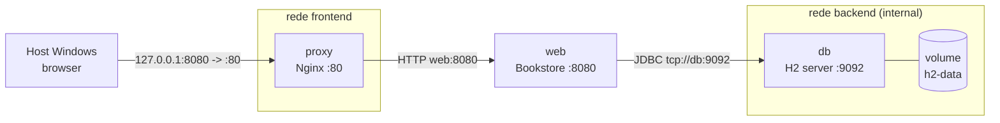

# CA4 - Containerization

## Relatório Técnico - Parte 1

**Unidade Curricular:** Configuração e Gestão de Sistemas (COGSI)  
**Mestrado:** Engenharia Informática / Engenharia de Segurança Informática  
**Instituto Superior de Engenharia do Porto (ISEP)**  

**Autores:**
- **1231013** - Tiago Fontes (50%)
- **1220788** - Pedro Rocha (50%)

---

## 1. Introdução

Este relatório documenta a realização da **Parte 1** do CA4, focada na contentorização da aplicação de Chat desenvolvida no CA1 utilizando **Docker**.

O objetivo principal desta fase foi empacotar e executar o servidor de chat em contentores Docker através de três abordagens distintas de construção (`Dockerfile`), aplicar boas práticas de segurança através da execução sob um utilizador *non-root*, recolher métricas comparativas (tempo de build, tamanho e camadas) e publicar as imagens resultantes no Docker Hub.

---

## 2. Estrutura dos Ficheiros

Os ficheiros desenvolvidos para a Parte 1 encontram-se estruturados na pasta `CA4/part1/chat-server/`:

```text
CA4/
├── README.md
├── .gitattributes
├── part1/
│   └── chat-server/
│       ├── .dockerignore
│       ├── .gitignore
│       ├── Dockerfile.v1       # Versão 1: build clonando o repositório na imagem
│       ├── Dockerfile.v2       # Versão 2: cópia do JAR compilado no host
│       ├── Dockerfile.v3       # Versão 3: multi-stage build com utilizador non-root
│       ├── app/
│       ├── gradle/
│       ├── gradlew
│       ├── gradlew.bat
│       ├── gradle.properties
│       └── settings.gradle
└── part2/                      # Docker Compose: proxy, web e db (ver Parte 2)
```

---

## 3. O Ficheiro `.dockerignore`

O ficheiro `.dockerignore` foi colocado na raiz de `CA4/part1/chat-server/` para filtrar os ficheiros enviados para o Docker Daemon durante a criação do contexto de construção:

```dockerignore
.git
.gradle
.idea
.vscode
*.log
*.tmp
.DS_Store
```

### Justificação:
1. **Redução do Contexto de Build:** Evita a transferência desnecessária de caches locais pesadas (`.gradle/`), acelerando o envio do contexto para o daemon.
2. **Segurança e Higiene:** Impede que metadados locais, histórico de commits (`.git`) ou ficheiros de configuração de IDEs sejam expostos nas camadas da imagem.
3. **Determinismo:** Garante que a compilação no container não reutiliza resíduos binários de compilações anteriores do host.

---

## 4. Implementação das 3 Versões de Dockerfile

### Versão 1: Build Clonando o Código na Imagem (`Dockerfile.v1`)
Esta versão descarrega as ferramentas necessárias (`git`, `bash`), clona o código do repositório diretamente dentro da imagem e compila a aplicação com o Gradle Wrapper:

```dockerfile
FROM eclipse-temurin:21-jdk-alpine

RUN apk add --no-cache git bash

WORKDIR /workspace

ARG REPO_URL=https://github.com/Rochaprtisep/cogsi2627-1220788-1231013.git
ARG REPO_BRANCH=main

RUN git clone --depth 1 --branch ${REPO_BRANCH} ${REPO_URL} repo && \
    if [ -d "repo/CA4/part1/chat-server" ]; then \
        cd repo/CA4/part1/chat-server; \
    else \
        cd repo/CA1/part1; \
    fi && \
    sed -i 's/\r$//' gradlew && \
    chmod +x gradlew && \
    ./gradlew clean build packageApp --no-daemon && \
    mkdir -p /app/lib && \
    cp app/build/libs/chat-server-*.jar /app/chat-server.jar && \
    cp -r app/build/libs/lib/* /app/lib/ && \
    rm -rf /workspace/repo

WORKDIR /app
EXPOSE 59001
ENTRYPOINT ["java", "-cp", "chat-server.jar:lib/*", "org.example.ChatServerApp", "59001"]
```

**Comando de build:**
```bash
docker build -f Dockerfile.v1 -t chat-server:v1 .
```

---

### Versão 2: Cópia do JAR Compilado no Host (`Dockerfile.v2`)
Nesta versão, a compilação é realizada previamente no host (`./gradlew clean build packageApp`). O Dockerfile apenas copia o artefacto JAR e a pasta de dependências `lib/` para uma imagem JRE Alpine mínima:

```dockerfile
FROM eclipse-temurin:21-jre-alpine

WORKDIR /app

COPY app/build/libs/chat-server-*.jar /app/chat-server.jar
COPY app/build/libs/lib /app/lib

EXPOSE 59001
ENTRYPOINT ["java", "-cp", "chat-server.jar:lib/*", "org.example.ChatServerApp", "59001"]
```

**Comando de build:**
```bash
docker build -f Dockerfile.v2 -t chat-server:v2 .
```

---

### Versão 3: Multi-Stage Build e Utilizador Non-Root (`Dockerfile.v3`)
Utiliza um primeiro estágio (`builder`) com JDK 21 para compilar o código fonte e um segundo estágio leve com JRE 21 Alpine para a execução, correndo a aplicação sob um utilizador dedicado sem privilégios (`appuser`):

```dockerfile
# Estagio 1: Build
FROM eclipse-temurin:21-jdk-alpine AS builder

WORKDIR /src
COPY . .

RUN apk add --no-cache bash && \
    sed -i 's/\r$//' gradlew && \
    chmod +x gradlew && \
    ./gradlew clean build packageApp --no-daemon

# Estagio 2: Runtime
FROM eclipse-temurin:21-jre-alpine

WORKDIR /app

# Criar grupo e utilizador sem privilegios
RUN addgroup -S appgroup && adduser -S appuser -G appgroup

# Copiar apenas os artefactos gerados e atribuir permissao ao appuser
COPY --from=builder --chown=appuser:appgroup /src/app/build/libs/chat-server-*.jar /app/chat-server.jar
COPY --from=builder --chown=appuser:appgroup /src/app/build/libs/lib /app/lib

USER appuser

EXPOSE 59001
ENTRYPOINT ["java", "-cp", "chat-server.jar:lib/*", "org.example.ChatServerApp", "59001"]
```

**Comando de build:**
```bash
docker build -f Dockerfile.v3 -t chat-server:v3 .
```

---

## 5. Justificação de Segurança: Execução Non-Root (`USER`)

A execução de contentores como `root` (UID 0) constitui um risco de segurança porque o UID 0 no contentor mapeia diretamente para o UID 0 no kernel do anfitrião (salvo se `userns-remap` estiver ativo).

A utilização da instrução `USER appuser` no `Dockerfile.v3` melhora a postura de segurança pelos seguintes motivos:

1. **Princípio do Menor Privilégio (*Least Privilege*):** A aplicação de chat necessita apenas de permissão para ler o JAR, abrir o socket na porta `59001` (porta não-privilegiada > 1024) e escrever logs. Não necessita de privilégios de administração do sistema.
2. **Mitigação de *Container Breakout*:** Em caso de vulnerabilidade de execução remota de código (RCE) na aplicação ou numa dependência (ex.: Log4j), o atacante obtém apenas os privilégios do utilizador `appuser`. Isto impede o acesso direto a ficheiros de configuração protegidos, montagem de dispositivos ou manipulação do kernel do host.
3. **Hardening do Sistema de Ficheiros:** O utilizador `appuser` não tem permissão para instalar novos pacotes via `apk` nem para modificar os binários do sistema operativo dentro do contentor.

**Comprovação do utilizador em execução:**
```bash
docker exec chat-srv id
# Output: uid=100(appuser) gid=101(appgroup) groups=101(appgroup)
```

---

## 6. Comparação das 3 Versões

Medições reais obtidas no ambiente de desenvolvimento:

| Métrica / Critério | Versão 1 (Clone na Imagem) | Versão 2 (Cópia de JAR do Host) | Versão 3 (Multi-Stage + Non-root) |
|---|---|---|---|
| **Tempo de Build Inicial** | ~28 s | ~1.5 s | ~22 s |
| **Tamanho da Imagem Final** | **881 MB** | **290 MB** | **290 MB** |
| **Tamanho Comprimido** | ~334 MB | ~76.2 MB | ~76.2 MB |
| **Número de Camadas** | 16 | 10 | 12 |
| **Dependências de Build na Imagem Final?** | **Sim** (JDK, Git, Gradle, cache) | **Não** (apenas JRE) | **Não** (apenas JRE) |
| **Utilizador de Execução** | `root` (UID 0) | `root` (UID 0) | `appuser` (UID 100) |
| **Superfície de Ataque** | Muito Elevada | Baixa | **Mínima** |

---

## 7. Análise de Camadas e Monitorização de Recursos

### Inspeção de Camadas (`docker history`)
O comando `docker history` demonstra claramente o impacto das escolhas de build:
- Na **Versão 1**, a instalação do Git/Bash e a camada de compilação adicionam cerca de 178 MB à imagem, para além dos 307 MB da base JDK.
- Na **Versão 3**, o estágio final descarta totalmente o compilador e as dependências temporárias do Gradle, mantendo apenas a base JRE (165 MB) e os binários da app (~2.4 MB).

### Monitorização em Tempo Real (`docker stats`)
Com o contentor `chat-srv` em execução contínua:

```text
CONTAINER ID   NAME       CPU %     MEM USAGE / LIMIT     MEM %     NET I/O         BLOCK I/O     PIDS
d7c6efa02cfd   chat-srv   0.12%     51.21MiB / 15.34GiB   0.33%     1.17kB / 126B   75.2MB / 0B   20
```

---

## 8. Verificação da Conectividade

O servidor foi iniciado com mapeamento de porta para o host:
```bash
docker run -d --name chat-srv -p 59001:59001 chat-server:v3
```

A verificação de conectividade a partir do anfitrião confirmou a disponibilidade do serviço:
```powershell
PS> Test-NetConnection -ComputerName localhost -Port 59001

ComputerName     : localhost
RemoteAddress    : ::1
RemotePort       : 59001
TcpTestSucceeded : True
```

---

## 9. Publicação no Docker Hub

As imagens foram tagueadas e publicadas no Docker Hub sob a conta `fontezz`:

- `fontezz/chat-server:v1`
- `fontezz/chat-server:v2`
- `fontezz/chat-server:v3`

Comandos utilizados:
```bash
docker tag chat-server:v1 fontezz/chat-server:v1
docker tag chat-server:v2 fontezz/chat-server:v2
docker tag chat-server:v3 fontezz/chat-server:v3

docker push fontezz/chat-server:v1
docker push fontezz/chat-server:v2
docker push fontezz/chat-server:v3
```

---

## 10. Autoavaliação

| Membro da Equipa | Número de Estudante | Contribuição (%) |
|---|---|---|
| Tiago Fontes | 1231013 | 50% |
| Pedro Rocha | 1220788 | 50% |

---
---

## Relatório Técnico - Parte 2

**Autores:**
- **1231013** - Tiago Fontes (50%)
- **1220788** - Pedro Rocha (50%)

---

## 1. Introdução

A **Parte 2** do CA4 coloca a aplicação **Bookstore** (`CA1/part2`, Spring Boot 3.5.9, Java 17) a correr em três contentores orquestrados com **Docker Compose**:

- **`proxy`**: Nginx, o único ponto de entrada a partir do host;
- **`web`**: a aplicação Bookstore, compilada a partir do código do `CA1/part2`;
- **`db`**: H2 em modo servidor (TCP), com os dados num volume Docker.

A arquitetura é a mesma do CA2 Parte 2, mas usa contentores em vez de VMs. Toda a configuração vem de variáveis de ambiente, lidas de um ficheiro `.env` que não é commitado. A ordem de arranque é garantida por *health checks* e `depends_on`.

---

## 2. Ambiente e Versões

| Componente | Versão |
|---|---|
| Host | Windows 11 + PowerShell |
| Docker Engine (Docker Desktop, backend WSL 2) | 29.6.1 |
| Docker Compose | 5.3.0 |
| Imagem de build do `web` | `eclipse-temurin:17-jdk-noble` |
| Imagem de runtime do `db` e do `web` | `eclipse-temurin:17-jre-alpine` (JDK 17.0.21+9) |
| Imagem do `proxy` | `nginx:1.28-alpine` (Nginx 1.28.3) |
| H2 Database (servidor e driver da aplicação) | 2.3.232 |
| Gradle Wrapper | 9.4.0 |

---

## 3. Arquitetura



| CA2 Parte 2 (Vagrant) | CA4 Parte 2 (Docker) |
|---|---|
| 3 VMs (`db`, `app`, `proxy`) | 3 contentores (`db`, `web`, `proxy`) |
| `Vagrantfile` + scripts shell | `compose.yaml` + 3 `Dockerfile` |
| IPs fixos `192.168.56.x` | Nomes dos serviços resolvidos pelo DNS do Docker |
| `ufw`: porta `9092` só a partir da `app` | Redes: o `db` só está na rede `backend`, que o `proxy` não vê |
| `ExecStartPre=wait-for-h2.sh` | `depends_on: condition: service_healthy` |
| Ficheiros em `/srv/h2` na VM `db` | Volume Docker `h2-data` |
| `secrets/db_password` + variáveis do Vagrant | `.env` (fora do Git) + variáveis do Compose |

---

## 4. Estrutura dos Ficheiros

```text
CA4/part2/
├── compose.yaml                  # 3 serviços, 2 redes, 1 volume
├── .env.example                  # modelo das variáveis (vai para o Git)
├── .env                          # valores reais (NÃO vai para o Git)
├── .gitignore
├── .gitattributes
├── db/
│   ├── Dockerfile                # H2 em modo servidor, utilizador h2
│   ├── .dockerignore
│   ├── docker-entrypoint.sh      # cria a BD na 1.ª vez e arranca o servidor
│   └── h2-healthcheck.sh         # SELECT 1 por TCP
├── web/
│   ├── Dockerfile                # multi-stage: JDK + Gradle -> JRE
│   └── Dockerfile.dockerignore   # contexto de build = CA1/part2
└── proxy/
    ├── Dockerfile                # nginx oficial + template
    ├── .dockerignore
    └── templates/default.conf.template
```

---

## 5. Configuração: `.env`, `.gitignore` e `.gitattributes`

Todas as variáveis estão num único `.env`, que o Compose lê automaticamente e usa para substituir `${VAR}` no `compose.yaml`. No Git só fica o modelo `.env.example`:

```dotenv
# --- Images (Docker Hub) ---
DOCKERHUB_USER=o-teu-utilizador
IMAGE_TAG=1.0.0

# --- db: credentials and storage ---
DB_NAME=bookstore
DB_USER=bookstore
DB_PASSWORD=muda-isto
DB_PORT=9092
H2_VERSION=2.3.232

# --- web: Spring Boot ---
WEB_PORT=8080

# --- proxy: port exposed on the host and routing settings ---
PROXY_BIND=127.0.0.1
PROXY_PORT=8080
PROXY_CONNECT_TIMEOUT=5s
PROXY_READ_TIMEOUT=30s
```

### Justificação:
1. **Um valor, um sítio.** O `DB_USER`, por exemplo, alimenta o `H2_USER` do `db` e o `SPRING_DATASOURCE_USERNAME` do `web`.
2. **Segredos fora do Git.** O `.gitignore` do `CA4/part2` ignora o `.env`. Tem também a exceção `!.env.example`, porque o `.gitignore` da raiz ignora `.env.*` e, sem ela, o modelo também ficava de fora.
3. **Falha cedo.** As variáveis obrigatórias usam `${VAR:?mensagem}`. Se faltar alguma, o Compose recusa-se a arrancar, em vez de criar uma base de dados sem password.
4. **Finais de linha LF.** O `.gitattributes` força `eol=lf` nos `.sh`, `Dockerfile`, `*.template` e `*.yaml`. Um script com CRLF falha dentro de um contentor Linux. Por segurança, os Dockerfiles também removem os `\r` com `sed`.

---

## 6. Contentor `db`: H2 em Modo Servidor

### `db/Dockerfile`
```dockerfile
ARG JRE_IMAGE=eclipse-temurin:17-jre-alpine

# --- Stage 1: download the H2 jar and check it against Maven Central's SHA-1 ---
FROM ${JRE_IMAGE} AS download
ARG H2_VERSION=2.3.232
RUN apk add --no-cache curl
RUN set -eux; \
    url="https://repo1.maven.org/maven2/com/h2database/h2/${H2_VERSION}/h2-${H2_VERSION}.jar"; \
    curl -fsSL --retry 3 -o /tmp/h2.jar      "$url"; \
    curl -fsSL --retry 3 -o /tmp/h2.jar.sha1 "$url.sha1"; \
    echo "$(cut -c1-40 /tmp/h2.jar.sha1)  /tmp/h2.jar" | sha1sum -c -

# --- Stage 2: runtime (JRE only) ---
FROM ${JRE_IMAGE}
RUN addgroup -S h2 \
 && adduser -S -G h2 -H -h /var/lib/h2 -s /sbin/nologin h2 \
 && mkdir -p /opt/h2 /var/lib/h2 \
 && chown h2:h2 /var/lib/h2 \
 && chmod 0750 /var/lib/h2

COPY --from=download /tmp/h2.jar /opt/h2/h2.jar
COPY docker-entrypoint.sh /usr/local/bin/docker-entrypoint.sh
COPY h2-healthcheck.sh    /usr/local/bin/h2-healthcheck
RUN sed -i 's/\r$//' /usr/local/bin/docker-entrypoint.sh /usr/local/bin/h2-healthcheck \
 && chmod 0755 /usr/local/bin/docker-entrypoint.sh /usr/local/bin/h2-healthcheck

ENV H2_PORT=9092 \
    H2_DB_NAME=bookstore \
    H2_DATA_DIR=/var/lib/h2 \
    H2_JAVA_OPTS="-Xmx256m"

USER h2
WORKDIR /var/lib/h2
VOLUME ["/var/lib/h2"]
EXPOSE 9092
ENTRYPOINT ["docker-entrypoint.sh"]
```

### `db/docker-entrypoint.sh` (parte principal)
```sh
if [ ! -f "$DB_FILE" ]; then
  echo "[db] Creating database '$H2_DB_NAME' (user '$H2_USER') in $H2_DATA_DIR"
  $H2 org.h2.tools.Shell -url "jdbc:h2:$H2_DATA_DIR/$H2_DB_NAME" \
      -user "$H2_USER" -password "$H2_PASSWORD" -sql "SELECT 1" > /dev/null
else
  echo "[db] Database '$H2_DB_NAME' already exists in $H2_DATA_DIR"
fi
exec $H2 org.h2.tools.Server -tcp -tcpAllowOthers -tcpPort "$H2_PORT" -baseDir "$H2_DATA_DIR"
```

### `db/h2-healthcheck.sh`
```sh
exec java -Xmx64m -cp /opt/h2/h2.jar org.h2.tools.Shell \
  -url "jdbc:h2:tcp://127.0.0.1:${H2_PORT}/${H2_DB_NAME}" \
  -user "$H2_USER" -password "$H2_PASSWORD" -sql "SELECT 1" > /dev/null 2>&1
```

### `db/.dockerignore`
```text
*
!Dockerfile
!docker-entrypoint.sh
!h2-healthcheck.sh
```

### Justificação:
1. **Mesma lógica do `db.sh` do CA2.** O jar do H2 vem do Maven Central e é verificado com o SHA-1 publicado. A base de dados é criada **localmente** com as credenciais da aplicação, e o servidor corre **sem** `-ifNotExists`, por isso nenhum cliente remoto pode criar bases de dados novas.
2. **H2 2.3.232**, a mesma versão do driver que o Spring Boot 3.5.9 põe dentro da Bookstore, para não haver incompatibilidades no formato dos ficheiros. É um `ARG`, por isso muda-se no `.env` (`H2_VERSION`).
3. **Multi-stage.** O `curl` só existe na fase `download`; a imagem final tem apenas a JRE, o jar e os dois scripts.
4. **Utilizador `h2` (não root).** É dono da pasta de dados, com permissões `0750`. É o mesmo princípio da conta de serviço `h2` do CA2/CA3.
5. **`exec` no entrypoint.** O Java passa a ser o PID 1 e recebe o `SIGTERM` do `docker stop`, por isso o H2 fecha a base de dados de forma limpa.
6. **Health check com `SELECT 1` por TCP.** Ter a porta aberta não chega: o H2 tem de aceitar as credenciais da aplicação e responder a uma *query*.
7. **`.dockerignore` em lista branca.** Só os 3 ficheiros necessários entram no contexto. Um `.env` ou um dump da BD esquecido na pasta nunca acaba numa imagem publicada.
8. **`H2_PASSWORD_FILE` (opcional).** Os dois scripts também aceitam a password num ficheiro, o que os deixa preparados para *Docker/Podman secrets*.

---

## 7. Contentor `web`: Bookstore

### `web/Dockerfile`
```dockerfile
# --- Stage 1: build with the full JDK and the Gradle wrapper ---
FROM eclipse-temurin:17-jdk-noble AS build
WORKDIR /src

COPY gradlew settings.gradle gradle.properties ./
COPY gradle/ gradle/
COPY app/build.gradle app/
RUN sed -i 's/\r$//' gradlew && chmod +x gradlew

COPY app/src/main/ app/src/main/
RUN --mount=type=cache,target=/root/.gradle \
    ./gradlew --no-daemon --console=plain :app:bootJar \
 && find app/build/libs -name '*.jar' ! -name '*-plain.jar' -exec cp {} /bookstore.jar \;

# --- Stage 2: runtime (JRE only: no JDK, no Gradle, no source code) ---
FROM eclipse-temurin:17-jre-alpine
RUN addgroup -S bookstore \
 && adduser -S -G bookstore -H -h /app -s /sbin/nologin bookstore
WORKDIR /app
COPY --from=build /bookstore.jar /app/bookstore.jar

USER bookstore
EXPOSE 8080
ENV JDK_JAVA_OPTIONS="-XX:MaxRAMPercentage=75.0"
ENTRYPOINT ["java", "-jar", "/app/bookstore.jar"]
```

### `web/Dockerfile.dockerignore`
O contexto de build é `CA1/part2`. Este ficheiro exclui `**/build/`, `**/.gradle/`, `**/bin/`, `**/out/`, os ficheiros de IDE, os logs, `gradlew.bat`, `app/src/test/` e `app/src/integrationTest/`.

### Justificação:
1. **Contexto = `CA1/part2`.** A imagem é compilada a partir do código que já está no repositório, sem uma segunda cópia da aplicação no CA4.
2. **`Dockerfile.dockerignore`.** Com o BuildKit, um ficheiro `<Dockerfile>.dockerignore` ao lado do Dockerfile tem prioridade sobre o `.dockerignore` do contexto. Assim o CA1 fica intacto, e os `build/` e `.gradle/` do host (centenas de MB, possivelmente com um jar antigo) não são enviados ao Docker.
3. **Multi-stage.** A fase `build` tem o JDK, o Gradle e o código; a imagem final só tem a JRE e o jar.
4. **Ordem das camadas + cache do Gradle.** Os ficheiros do Gradle são copiados antes do código, e o `--mount=type=cache` guarda as dependências entre builds sem as meter em nenhuma camada.
5. **`bootJar` sem testes.** Os testes pertencem ao CI, como no CA3.
6. **Build em Ubuntu, runtime em Alpine.** O Gradle usa bibliotecas nativas pensadas para glibc; a JRE da Temurin funciona em Alpine e dá uma imagem final mais pequena.
7. **Utilizador `bookstore`; jar com dono `root`.** A aplicação lê o jar mas não o consegue alterar.
8. **`-XX:MaxRAMPercentage=75.0`.** O heap é calculado a partir do limite de memória do contentor (1 GB), não da memória do host.

---

## 8. Contentor `proxy`: Nginx

### `proxy/templates/default.conf.template`
```nginx
upstream bookstore_web {
    server ${BACKEND_HOST}:${BACKEND_PORT};
}

server {
    listen ${NGINX_PORT} default_server;
    server_name _;

    location = /nginx-health {
        access_log off;
        default_type text/plain;
        return 200 "ok\n";
    }

    location / {
        proxy_pass http://bookstore_web;
        proxy_set_header Host              $http_host;
        proxy_set_header X-Real-IP         $remote_addr;
        proxy_set_header X-Forwarded-For   $proxy_add_x_forwarded_for;
        proxy_set_header X-Forwarded-Proto $scheme;
        proxy_connect_timeout ${PROXY_CONNECT_TIMEOUT};
        proxy_read_timeout    ${PROXY_READ_TIMEOUT};
    }
}
```

### `proxy/Dockerfile`
```dockerfile
FROM nginx:1.28-alpine
COPY templates/ /etc/nginx/templates/
RUN sed -i 's/\r$//' /etc/nginx/templates/*.template
ENV NGINX_PORT=80 \
    BACKEND_HOST=web \
    BACKEND_PORT=8080 \
    PROXY_CONNECT_TIMEOUT=5s \
    PROXY_READ_TIMEOUT=30s
EXPOSE 80
```

### Justificação:
1. **Templates da imagem oficial.** No arranque, a imagem `nginx` corre o `envsubst` sobre `/etc/nginx/templates/*.template` e escreve o resultado em `/etc/nginx/conf.d/`. Só substitui variáveis que existem no ambiente, por isso as do Nginx (`$http_host`, `$remote_addr`) ficam intactas. No CA2 isto era feito com um `sed` no script de provisionamento.
2. **`Host $http_host`.** Mantém a porta (`localhost:8080`), para os links HATEOAS apontarem de volta para o proxy.
3. **`/nginx-health`.** É um health check do próprio Nginx, que não toca na aplicação. Assim, "o Nginx está em baixo" distingue-se de "a aplicação está em baixo".
4. **Versão fixa (`1.28-alpine`)** em vez de `latest`, para a imagem não mudar sozinha entre builds.
5. **O `proxy` corre como root.** O processo *master* do Nginx precisa disso para escutar na porta 80; os *workers* correm como `nginx`. Os dois contentores próprios (`db` e `web`) correm sem privilégios.

---

## 9. Orquestração: `compose.yaml`

```yaml
name: cogsi-ca4

services:
  db:
    build:
      context: ./db
      args:
        H2_VERSION: ${H2_VERSION:-2.3.232}
    image: ${DOCKERHUB_USER:?set DOCKERHUB_USER in .env}/cogsi-ca4-db:${IMAGE_TAG:-1.0.0}
    environment:
      H2_DB_NAME: ${DB_NAME:-bookstore}
      H2_USER: ${DB_USER:?set DB_USER in .env}
      H2_PASSWORD: ${DB_PASSWORD:?set DB_PASSWORD in .env}
      H2_PORT: ${DB_PORT:-9092}
      H2_DATA_DIR: /var/lib/h2
    volumes:
      - h2-data:/var/lib/h2
    networks:
      - backend
    healthcheck:
      test: ["CMD", "h2-healthcheck"]
      interval: 10s
      timeout: 10s
      retries: 5
      start_period: 30s
      start_interval: 2s
    deploy:
      resources:
        limits:
          memory: 512m
    restart: unless-stopped

  web:
    build:
      context: ../../CA1/part2
      dockerfile: ../../CA4/part2/web/Dockerfile
    image: ${DOCKERHUB_USER:?set DOCKERHUB_USER in .env}/cogsi-ca4-web:${IMAGE_TAG:-1.0.0}
    environment:
      SERVER_PORT: ${WEB_PORT:-8080}
      SPRING_DATASOURCE_URL: jdbc:h2:tcp://db:${DB_PORT:-9092}/${DB_NAME:-bookstore}
      SPRING_DATASOURCE_USERNAME: ${DB_USER:?set DB_USER in .env}
      SPRING_DATASOURCE_PASSWORD: ${DB_PASSWORD:?set DB_PASSWORD in .env}
      SPRING_JPA_HIBERNATE_DDLAUTO: update
      SPRING_JPA_SHOWSQL: "false"
      SPRING_H2_CONSOLE_ENABLED: "false"
      MANAGEMENT_ENDPOINT_HEALTH_SHOWCOMPONENTS: always
    depends_on:
      db:
        condition: service_healthy
    networks:
      - backend
      - frontend
    healthcheck:
      test: ["CMD-SHELL", "wget -qO /dev/null http://127.0.0.1:$${SERVER_PORT}/actuator/health || exit 1"]
      interval: 10s
      timeout: 5s
      retries: 5
      start_period: 90s
      start_interval: 3s
    deploy:
      resources:
        limits:
          memory: 1g
    restart: unless-stopped

  proxy:
    build: ./proxy
    image: ${DOCKERHUB_USER:?set DOCKERHUB_USER in .env}/cogsi-ca4-proxy:${IMAGE_TAG:-1.0.0}
    environment:
      NGINX_PORT: 80
      BACKEND_HOST: web
      BACKEND_PORT: ${WEB_PORT:-8080}
      PROXY_CONNECT_TIMEOUT: ${PROXY_CONNECT_TIMEOUT:-5s}
      PROXY_READ_TIMEOUT: ${PROXY_READ_TIMEOUT:-30s}
    ports:
      - "${PROXY_BIND:-127.0.0.1}:${PROXY_PORT:-8080}:80"
    depends_on:
      web:
        condition: service_healthy
        restart: true
    networks:
      - frontend
    healthcheck:
      test: ["CMD-SHELL", "wget -qO- http://127.0.0.1:$${NGINX_PORT}/nginx-health | grep -q ok"]
      interval: 10s
      timeout: 3s
      retries: 3
      start_period: 5s
    restart: unless-stopped

networks:
  frontend: {}
  backend:
    internal: true

volumes:
  h2-data: {}
```

### Justificação:
1. **Duas redes.** A `frontend` liga `proxy` ↔ `web`; a `backend` liga `web` ↔ `db` e é `internal: true` (sem saída para fora). O `web` é o único contentor nas duas. É o equivalente à regra `ufw` do CA2: o `proxy` nem consegue resolver o nome `db`.
2. **Só o `proxy` publica uma porta**, e apenas em `127.0.0.1`, para não ficar visível na rede local (como o `host_ip` do Vagrantfile).
3. **Volume com nome `h2-data`.** Os dados ficam fora do sistema de ficheiros do contentor e sobrevivem a `docker compose down`. Evita um *bind mount* para uma pasta do Windows, que seria lento e com permissões imprevisíveis através do WSL (o mesmo problema do `vboxsf` no CA3).
4. **Configuração do Spring por variáveis de ambiente.** O Spring Boot aceita qualquer propriedade em maiúsculas, com `.` → `_` e sem hífens (`spring.jpa.hibernate.ddl-auto` → `SPRING_JPA_HIBERNATE_DDLAUTO`). Estas variáveis têm prioridade sobre o `application.properties` do jar, por isso o CA1 não muda. O URL JDBC usa o nome do serviço `db`, que o DNS do Docker resolve.
5. **`depends_on: condition: service_healthy`.** O `web` só arranca depois de o `db` responder ao `SELECT 1`, e o `proxy` só depois de o `/actuator/health` do `web` responder `200`. Substitui o `wait-for-h2.sh` do CA2 e garante que o Nginx encontra o `upstream web` no arranque.
6. **`restart: true` no `proxy`.** O Nginx guarda o IP do `web` que resolveu no arranque. Quando o Compose recria o `web`, reinicia também o `proxy`, para não ficar a dar `502`.
7. **`start_period` + `start_interval`.** Durante o arranque, as falhas não contam e o teste corre mais vezes (de 2 em 2 s no `db`, de 3 em 3 s no `web`). Cada serviço fica *healthy* assim que está pronto, sem esperar pelos 10 s do `interval`.
8. **Limites de memória.** 512 MB no `db` (heap de 256 MB e uma JVM pequena em cada health check) e 1 GB no `web`.

---

## 10. Testes

Todos os comandos foram corridos em `CA4/part2`.

### 10.1 Arranque e ordem
```text
PS> docker compose up -d --wait
 ✔ Network cogsi-ca4_backend   Created
 ✔ Network cogsi-ca4_frontend  Created
 ✔ Container cogsi-ca4-db-1    Healthy
 ✔ Container cogsi-ca4-web-1   Healthy
 ✔ Container cogsi-ca4-proxy-1 Healthy

PS> foreach ($c in "db","web","proxy") { "{0,-6} started {1}" -f $c, (docker inspect --format '{{.State.StartedAt}}' "cogsi-ca4-$c-1") }
db     started 2026-11-08T03:43:18.251891745Z
web    started 2026-11-08T03:43:20.916970982Z
proxy  started 2026-11-08T03:43:27.6575686Z
```
O `web` arrancou cerca de 2,7 s depois do `db`, ou seja, assim que o `SELECT 1` do health check teve sucesso. O `proxy` arrancou cerca de 6,7 s depois do `web`, o tempo que o Spring Boot demorou a responder no `/actuator/health`.

```text
PS> docker compose ps
NAME                IMAGE                               SERVICE   STATUS                       PORTS
cogsi-ca4-db-1      devaurizzon/cogsi-ca4-db:1.0.0      db        Up About an hour (healthy)   9092/tcp
cogsi-ca4-proxy-1   devaurizzon/cogsi-ca4-proxy:1.0.0   proxy     Up About an hour (healthy)   127.0.0.1:8080->80/tcp
cogsi-ca4-web-1     devaurizzon/cogsi-ca4-web:1.0.0     web       Up About an hour (healthy)   8080/tcp
```

### 10.2 DNS interno e conectividade
```text
PS> docker compose exec web cat /etc/resolv.conf
nameserver 127.0.0.11

PS> docker compose exec web nslookup db
Name:   db
Address: 172.19.0.2

PS> docker compose exec proxy nslookup web
Name:   web
Address: 172.20.0.2

PS> docker compose exec proxy wget -qO- http://web:8080/actuator/health
{"status":"UP","components":{"db":{"status":"UP"},"diskSpace":{"status":"UP"},"ping":{"status":"UP"},"ssl":{"status":"UP"}}}

PS> docker compose exec db h2-healthcheck; echo "db SELECT 1 -> exit $LASTEXITCODE"
db SELECT 1 -> exit 0
```
Os contentores encontram-se pelo nome do serviço através do DNS embutido do Docker (`127.0.0.11`). O `/actuator/health`, pedido a partir do `proxy`, mostra a ligação à base de dados `UP`.

### 10.3 Isolamento de rede
```text
PS> docker compose exec proxy nslookup db
;; connection timed out; no servers could be reached

PS> docker compose exec proxy wget -T 3 -qO- http://db:9092; echo "proxy -> db: exit $LASTEXITCODE"
wget: bad address 'db:9092'
proxy -> db: exit 1

PS> docker compose exec db wget -T 3 -qO- http://example.com; echo "db -> internet: exit $LASTEXITCODE"
wget: bad address 'example.com'
db -> internet: exit 1

PS> Test-NetConnection 127.0.0.1 -Port 9092 | Select-Object TcpTestSucceeded
False
PS> Test-NetConnection 127.0.0.1 -Port 8080 | Select-Object TcpTestSucceeded
True
```

Membros de cada rede (`docker network inspect`):

| Rede | Contentores |
|---|---|
| `cogsi-ca4_backend` | `cogsi-ca4-db-1` (172.19.0.2), `cogsi-ca4-web-1` (172.19.0.3) |
| `cogsi-ca4_frontend` | `cogsi-ca4-web-1` (172.20.0.2), `cogsi-ca4-proxy-1` (172.20.0.3) |

| Origem → destino | Resultado | Porquê |
|---|---|---|
| `web` → `db:9092` | aberto | ambos na `backend` |
| `proxy` → `web:8080` | aberto | ambos na `frontend` |
| `proxy` → `db:9092` | **fechado** (o nome nem resolve) | o `proxy` não está na `backend` |
| `db` → internet | **fechado** | a `backend` é `internal` |
| host → `db:9092` | **fechado** | o `db` não tem `ports:` |
| host → `proxy:8080` | aberto | único serviço com `ports:` |

### 10.4 Health checks: falha da base de dados
```text
PS> docker compose stop db
PS> Start-Sleep -Seconds 70
PS> docker compose ps
NAME                SERVICE   STATUS                          PORTS
cogsi-ca4-proxy-1   proxy     Up About a minute (healthy)     127.0.0.1:8080->80/tcp
cogsi-ca4-web-1     web       Up About a minute (unhealthy)   8080/tcp

PS> curl.exe -s -i http://localhost:8080/actuator/health
HTTP/1.1 504 Gateway Time-out
Server: nginx/1.28.3

PS> docker compose start db
PS> Start-Sleep -Seconds 40
PS> docker compose ps
NAME                SERVICE   STATUS                    PORTS
cogsi-ca4-db-1      db        Up 40 seconds (healthy)   9092/tcp
cogsi-ca4-proxy-1   proxy     Up 2 minutes (healthy)    127.0.0.1:8080->80/tcp
cogsi-ca4-web-1     web       Up 2 minutes (healthy)    8080/tcp
```
- Com o `db` parado, o `web` passou a **`unhealthy`**. O health check (`wget` com *timeout* de 5 s) deixa de receber um `200` do `/actuator/health`.
- O pedido através do proxy deu **`504`** e não o `503` que se esperava. O indicador de saúde da BD fica à espera de uma ligação do *pool* (HikariCP, `connectionTimeout` de 30 s por omissão), e o `proxy_read_timeout 30s` do Nginx esgota antes de o Spring responder. Em qualquer dos casos, a falha da BD é detetada e propaga-se ao estado do `web`.
- O `proxy` manteve-se **`healthy`**, porque o seu health check (`/nginx-health`) não depende da aplicação.
- Depois de `docker compose start db`, o `web` voltou a **`healthy` sozinho**, sem ser reiniciado: o *pool* de ligações voltou a ligar-se ao H2.

### 10.5 Persistência no volume
Antes dos testes foi criado um livro através do proxy:
```text
PS> Invoke-RestMethod -Method Post -Uri http://localhost:8080/books -ContentType "application/json" `
      -Body '{"title":"Continuous Delivery","author":"Jez Humble","price":45}'
id title               author     price
-- -----               ------     -----
52 Continuous Delivery Jez Humble  45,0
```

| # | Ação | Contentor `db` | Volume `h2-data` | Log do `db` |
|---|---|---|---|---|
| 1 | `docker compose restart db` | o mesmo | mantido | — |
| 2 | `docker compose rm -sf db` + `up -d --wait` | **novo** | mantido | `Database 'bookstore' already exists` |
| 3 | `docker compose down` + `up -d --wait` | os 3 contentores e as redes são novos | mantido (`docker volume ls` mostra `cogsi-ca4_h2-data`) | — |
| 4 | `docker compose down -v` + `up -d --wait` (contraprova) | novo | **apagado e recriado** | `Creating database 'bookstore'` |

Log do teste 2 (contentor novo, dados antigos):
```text
db-1  | [db] Database 'bookstore' already exists in /var/lib/h2
db-1  | [db] Starting H2 TCP server on port 9092
db-1  | TCP server running at tcp://172.19.0.2:9092 (others can connect)
```
Log do teste 4 (volume apagado):
```text
 ✔ Volume cogsi-ca4_h2-data    Removed
 ✔ Volume cogsi-ca4_h2-data    Created
db-1  | [db] Creating database 'bookstore' (user 'bookstore') in /var/lib/h2
```
A base de dados sobrevive a reinícios, à recriação do contentor e a um `down` completo. Só desaparece quando o volume é apagado, o que prova que os dados estão **só** no volume e não no sistema de ficheiros do contentor.

### 10.6 Configuração por variáveis de ambiente
Configuração do Nginx gerada a partir do template, já com os valores substituídos:
```text
PS> docker compose exec proxy cat /etc/nginx/conf.d/default.conf
upstream bookstore_web {
    server web:8080;
}
server {
    listen 80 default_server;
    ...
        proxy_connect_timeout 5s;
        proxy_read_timeout    30s;
```

As imagens **não contêm segredos**; as credenciais só entram quando o contentor é criado:
```text
PS> docker image inspect devaurizzon/cogsi-ca4-web:1.0.0 --format '{{json .Config.Env}}'
["PATH=...","JAVA_HOME=/opt/java/openjdk","LANG=en_US.UTF-8",...,"JAVA_VERSION=jdk-17.0.21+9","JDK_JAVA_OPTIONS=-XX:MaxRAMPercentage=75.0"]

PS> docker image inspect devaurizzon/cogsi-ca4-db:1.0.0 --format '{{json .Config.Env}}'
["PATH=...",...,"H2_PORT=9092","H2_DB_NAME=bookstore","H2_DATA_DIR=/var/lib/h2","H2_JAVA_OPTS=-Xmx256m"]
```
**Limitação:** o `docker inspect` dos *contentores* (não das imagens) e o `docker compose config` mostram a password em claro. Em produção usar-se-iam *secrets* (ficheiros em `/run/secrets`). Os scripts do `db` já estão preparados para isso com o `H2_PASSWORD_FILE`.

### 10.7 Tamanho das imagens
| Imagem | Tamanho em disco | Tamanho comprimido |
|---|---|---|
| `devaurizzon/cogsi-ca4-db:1.0.0` | 262 MB | 70.7 MB |
| `devaurizzon/cogsi-ca4-web:1.0.0` | 366 MB | 120 MB |
| `devaurizzon/cogsi-ca4-proxy:1.0.0` | 92.5 MB | 26 MB |

Graças ao *multi-stage*, nenhuma imagem leva o JDK, o Gradle, o `curl` ou o código-fonte.

---

## 11. Alternativa ao Docker (Análise)

O enunciado pede a análise de uma alternativa que não seja baseada no Docker. Esta secção apresenta a análise e o desenho da solução; a alternativa **não foi implementada**.

### 11.1 Comparação

| Característica | Docker | Podman | containerd + nerdctl | LXC / Incus |
|---|---|---|---|---|
| Arquitetura | Daemon (`dockerd`) com root | Sem daemon (cada contentor é um processo filho do `conmon`) | Daemon `containerd` + CLI compatível | Daemon (`incusd`) |
| Tipo de contentor | Aplicação | Aplicação; também *pods* (como no Kubernetes) | Aplicação | **Sistema** (SO completo com `systemd`) |
| Rootless | Opcional | Por omissão | Opcional (RootlessKit) | Contentores sem privilégios por omissão |
| Imagens | OCI / Docker | OCI / Docker (as mesmas do Docker Hub) | OCI / Docker | Imagens próprias |
| Build | `docker build` (BuildKit) | `podman build` (Buildah), aceita o mesmo Dockerfile | `nerdctl build` (precisa do `buildkitd`) | Sem Dockerfile: perfis, `cloud-init` |
| Multi-contentor | Compose | `podman compose`, `podman kube play`, Quadlet (`systemd`) | `nerdctl compose` (subconjunto) | Perfis + scripts |
| Esperar por dependência *healthy* | `depends_on: condition: service_healthy` | Não existe no CLI; `podman wait --condition=healthy` ou Quadlet (`Notify=healthy` + `Requires=`/`After=`) | Suporte limitado | Não existe |
| Redes / DNS por nome | *Bridge* + DNS embutido | `netavark` + `aardvark-dns` | CNI + DNS | *Bridge* `incusbr0` + DNS |
| Segredos | `secrets` (ficheiros) | `podman secret` como ficheiro **ou** variável de ambiente | Não nativo | Não nativo |
| Windows | Docker Desktop (WSL 2) | Podman Desktop / `podman machine` (WSL 2) | Rancher Desktop | Só dentro de uma VM Linux |

### 11.2 Desenho da solução com cada alternativa
- **containerd + nerdctl.** O `nerdctl compose up` lê o mesmo `compose.yaml`, por isso o desenho seria quase idêntico. O risco está nas funcionalidades que o `nerdctl` não implementa por completo (`condition: service_healthy`, `restart: true`), que teriam de ser substituídas por um script de espera.
- **LXC / Incus.** Três contentores de **sistema** Ubuntu, configurados como as VMs do CA2/CA3 (pacotes, serviços `systemd`, o Ansible do CA3), com rede *bridge* com DNS por nome, um *storage volume* em `/srv/h2` e *ACLs* de rede no lugar do `ufw`. É a opção mais distante do Docker: não há imagens por aplicação nem Dockerfile, por isso a publicação no Docker Hub não se aplicaria.
- **Podman (alternativa escolhida).** Usaria as mesmas três imagens OCI, puxadas do Docker Hub ou construídas com `podman build` a partir dos mesmos Dockerfiles (com `--format docker`, para não perder o `HEALTHCHECK`). Teria duas redes (`backend` com `--internal`, `frontend`), um volume e um `podman secret` com a password. Os contentores teriam `--network-alias db`/`web`, para os URLs não mudarem.

### 11.3 Como os requisitos seriam cobertos com Podman

| Requisito | Com Podman | Observação |
|---|---|---|
| Orquestração (Compose) | `podman compose`, Quadlet ou um script | Num Linux com `systemd`, o caminho correto seria Quadlet (ficheiros `.container`, `.network`, `.volume`) |
| `depends_on: condition: service_healthy` | Quadlet: `Notify=healthy` + `Requires=`/`After=`; ou `podman wait --condition=healthy` num script | Não existe no CLI do Podman |
| `depends_on: restart: true` | Não existe | Teria de ser feito pelo `systemd` ou pelo script |
| Health checks | `--health-*` | Executados por *timers* do `systemd`, porque não há daemon |
| Variáveis de ambiente / password | `podman secret` (`type=env` ou ficheiro em `/run/secrets`) | Mais seguro do que no Compose: a password não aparece no `inspect`. O `H2_PASSWORD_FILE` do `db` já está preparado |
| Volume e redes isoladas | `podman volume`, `podman network create --internal` | Equivalente direto |
| Imagens no Docker Hub | As mesmas imagens; `podman push` | Ambos seguem a especificação OCI |

### 11.4 Escolha e reflexão
O **Podman** foi a alternativa escolhida, por quatro razões:
- **Usa as mesmas imagens e os mesmos Dockerfiles.** A comparação é justa, porque só muda a ferramenta.
- **Funciona no Windows.**
- **É sem daemon e rootless por omissão.** No Docker, tudo passa pelo `dockerd` (um processo root). No Podman, cada contentor é um processo do utilizador, e o root *dentro* do contentor é um UID sem privilégios *fora* dele.
- **Obriga a mudar o desenho.** Sem um equivalente direto ao `depends_on` declarativo do Compose, a ordem e as esperas passam para o `systemd` (Quadlet) ou para um script. Isso mostra o trabalho que o Compose faz sozinho.

---

## 12. Problemas Encontrados

| # | Problema | Causa | Solução |
|---|---|---|---|
| 1 | O Docker Desktop não arranca (`WSL 2` / `Virtual Machine Platform`) | Hipervisor do Windows desligado no CA2 para o VirtualBox funcionar | `VirtualMachinePlatform` + `bcdedit /set hypervisorlaunchtype auto` + reiniciar |
| 2 | As VMs do Vagrant voltam a dar *timeout* | Hipervisor ligado para o Docker | Alternar com `bcdedit` conforme o CA em que se está a trabalhar |
| 3 | O `.env.example` não aparece no `git status` | `.env.*` no `.gitignore` da raiz | `!.env.example` no `.gitignore` do `CA4/part2` |
| 4 | Contexto de build do `web` com centenas de MB / risco de jar antigo na imagem | `build/` e `.gradle/` do host enviados ao Docker | `web/Dockerfile.dockerignore` |
| 5 | Propriedades do Spring ignoradas | Hífen no nome da variável (`SHOW_COMPONENTS`) | Sem hífens: `SHOWCOMPONENTS`, `DDLAUTO` |
| 6 | `(Invoke-RestMethod .../books)._embedded.bookList` não mostra nada | `GET /books` devolve uma lista JSON simples (`List<Book>`), não um objeto HAL com `_embedded` | `Invoke-RestMethod http://localhost:8080/books \| Format-Table id, title, author, price` |
| 7 | `504` em vez de `503` no `/actuator/health` com o `db` parado | O health check da BD espera pelo *timeout* do *pool* (30 s), que coincide com o `proxy_read_timeout` do Nginx | Comportamento esperado; o estado `unhealthy` do `web` é detetado na mesma |

---

## 13. Autoavaliação

| Membro da Equipa | Número de Estudante | Contribuição (%) |
|---|---|---|
| Tiago Fontes | 1231013 | 50% |
| Pedro Rocha | 1220788 | 50% |
