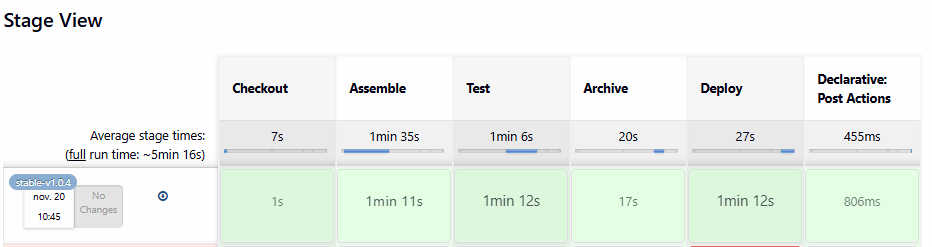

# CA5 — CI/CD Pipelines

## Relatório Técnico — Parte 1

**Unidade Curricular:** Configuração e Gestão de Sistemas (COGSI)  
**Mestrado:** Engenharia Informática / Engenharia de Segurança Informática  
**Instituto Superior de Engenharia do Porto (ISEP)**  

**Autores:**
- **1231013** — Tiago Fontes (50%)
- **1220788** — Pedro Rocha (50%)

---

## 1. Introdução e Ambiente

Este relatório documenta a conceção, implementação e validação do **Assignment 5 (CA5)**, dedicado à automação do ciclo de vida de software através de **Pipelines de Integração Contínua e Entrega Contínua (CI/CD)**.

O objetivo da **Parte 1** consiste em automatizar a construção, teste unitário, arquivo com integridade criptográfica e deployment contínuo da aplicação **Bookstore** (baseada em Spring Boot e Gradle, desenvolvida no CA1) através de uma pipeline declarativa em **Jenkins**, aplicando uma estratégia de deployment **Blue/Green** automatizada com **Ansible** sobre máquinas virtuais geridas por **Vagrant**, complementada com um mecanismo idempotente de **Rollback**.

### Ferramentas e Versões Utilizadas

| Ferramenta / Componente | Versão / Especificação | Finalidade no Projeto |
|---|---|---|
| **Host OS** | Windows 11 Pro 64-bit | Execução do Hypervisor e Jenkins Controller |
| **Hypervisor** | Oracle VM VirtualBox 7.1.x | Execução das máquinas virtuais do cluster |
| **IaC / Virtualização** | Vagrant 2.4.x (`bento/ubuntu-22.04`) | Provisionamento automatizado e isolado das VMs |
| **Gestão de Configuração** | Ansible Core 2.14+ (no nó `ctrl`) | Automação de runtime, deploy e rollback |
| **CI/CD Server** | Jenkins 2.580.2 | Orquestração da pipeline declarativa |
| **Java Runtimes** | OpenJDK 21 (Jenkins) / OpenJDK 17 (App) | Execução do Jenkins Controller e do Bookstore |
| **Build Tool** | Gradle 9.4 (via Gradle Wrapper) | Compilação, teste e empacotamento da app |
| **Controlo de Versões** | Git 2.47+ / GitHub | Controlo de versões, branches e webhooks |

---

## 2. Arquitetura da Solução

### Topologia de Nós e Endereçamento

Para garantir a separação de responsabilidades e permitir a estratégia de deployment Blue/Green, foram configurados 4 intervenientes principais:

| Nó | IP / Interface | Sistema Operativo | Papel e Responsabilidades |
|---|---|---|---|
| **Host (Jenkins Controller)** | `localhost:9090` | Windows 11 | Gestor da orquestração Jenkins, interface web, gestão de credenciais e histórico de builds. |
| **ctrl (Agente Jenkins + Ansible)** | `192.168.56.20` | Ubuntu 22.04 LTS | Agente Linux de build (SSH), nó de controlo Ansible, compilação Gradle e execução de testes. |
| **blue (Ambiente Atual / Produção)** | `192.168.56.21` | Ubuntu 22.04 LTS | Aloja a versão base em produção (`v1.0.0`) com base de dados H2 embedded e serviço systemd. |
| **green (Ambiente Candidato / Staging)** | `192.168.56.22` | Ubuntu 22.04 LTS | Ambiente alvo de novas releases estáveis (`v1.0.X`) e de procedimentos de rollback. |

### Justificação das Decisões de Arquitetura

1. **Jenkins Controller nativo em Windows na porta 9090:**
   - Evita colisão direta com a porta padrão `8080` utilizada pelos serviços Spring Boot do Bookstore.
   - Permite tirar partido do JDK 21 instalado no host sem necessidade de emuladores ou WSL2 com restrições de rede.
2. **VM `ctrl` como Agente Jenkins Linux via SSH:**
   - O Ansible não corre nativamente em sistemas operativos Windows (requer chamadas POSIX e controlo estrito de permissões `0600` em ficheiros de chaves privadas SSH).
   - Ao registar a VM `ctrl` como agente SSH do Jenkins (`agent { label 'ca5-p1' }`), todas as tarefas pesadas de compilação, testes e execução de playbooks correm diretamente em ambiente Linux nativo, garantindo isolamento total em relação ao host Windows.
3. **Pares de Chaves SSH Ed25519 Geradas por VM:**
   - No arranque do Vagrant, são geradas chaves assimétricas dedicadas por cada máquina (`keys/ctrl`, `keys/blue`, `keys/green`). O nó `ctrl` recebe apenas a chave pública autorizada e a chave privada necessária para contactar `blue` e `green`.
4. **Dimensionamento de Recursos:**
   - Foi atribuída **1 vCPU e 1024 MB de RAM** por VM (com 2048 MB no `ctrl` para suporte ao Gradle e ao agente Jenkins), garantindo estabilidade no hypervisor e compatibilidade total com o hardware host.

---

## 3. Parte 1 — Pipeline Gradle com Deploy Blue/Green em VMs

### 3.1. Rastreabilidade e Versionamento Dinâmico

Para assegurar a rastreabilidade entre cada commit/build no Jenkins e o artefacto gerado, o ficheiro `CA1/part2/app/build.gradle` foi modificado para suportar a injeção da versão por propriedade do Gradle:

```groovy
version = findProperty('appVersion') ?: '1.0.0'
```

* **Comportamento por omissão:** Em builds locais de desenvolvimento sem parâmetros, a versão mantém-se `1.0.0`.
* **Comportamento em CI:** O Jenkins injeta o identificador semântico de build através da flag `-PappVersion="stable-v1.0.${BUILD_NUMBER}"`, gerando um binário único e auditável: `bookstore-stable-v1.0.N.jar`.

### 3.2. Infraestrutura Vagrant (`CA5/part1/Vagrantfile`)

O `Vagrantfile` define a rede privada `192.168.56.0/24` e provisiona as três VMs:
* Configura as interfaces de rede com IPs estáticos.
* Gera no host o par de chaves SSH `ed25519` para cada VM na pasta `keys/`.
* No nó `ctrl`, executa o script de bootstrap `provision/ctrl.sh`:
  - Instala `ansible`, `git`, `openjdk-17-jdk` (para build e execução do Bookstore) e `openjdk-21-jre-headless` (para o agente de execução do Jenkins).
  - Garante permissões estritas `0600` nas chaves SSH copiadas para `/home/vagrant/.ssh/`.

Comando de inicialização:
```powershell
cd CA5/part1
vagrant up
```

### 3.3. Automação e Provisionamento com Ansible

A pasta `CA5/part1/ansible/` organiza a infraestrutura como código (IaC) de forma modular:

* **`hosts.ini`:**
  ```ini
  [ctrl]
  localhost ansible_connection=local

  [blue]
  192.168.56.21 ansible_user=vagrant ansible_ssh_private_key_file=/home/vagrant/.ssh/id_blue

  [green]
  192.168.56.22 ansible_user=vagrant ansible_ssh_private_key_file=/home/vagrant/.ssh/id_green
  ```

* **Roles Desenvolvidas:**
  1. `common`: Atualização de repositórios, dependências base e criação do utilizador de sistema `vagrant`.
  2. `bookstore_runtime`: Criação da árvore de pastas `/opt/bookstore/` (`releases/`, `data/`, `log/`), configuração da firewall e criação do serviço `systemd` (`bookstore.service`) que aponta sempre para o link simbólico `/opt/bookstore/current.jar`.
  3. `bookstore_artifact`: Faz download autenticado de uma versão arquivada no Jenkins usando a REST API, atualiza o symlink de forma atómica, reinicia o serviço systemd e valida a saúde da aplicação nos endpoints `/actuator/health` e `/info/details`.

* **Playbooks:**
  - `site.yml`: Provisiona os nós `blue` e `green`, compila localmente no `ctrl` a versão inicial `1.0.0` e faz o deploy base no ambiente `blue`.
  - `deploy-green.yml`: Efetua o deploy da nova versão candidata gerada pelo Jenkins exclusivamente no nó `green`.
  - `rollback.yml`: Restaura uma versão estável anterior no nó `green`.

### 3.4. Configuração do Jenkins e Segurança de Credenciais

De acordo com as boas práticas do setor e os requisitos do trabalho, **nenhum segredo, password ou chave privada reside no repositório**:

1. **Agente SSH `ctrl`:**
   - Configurado no menu *Gerir o Jenkins > Nós > Novo Nó*.
   - Nome: `ctrl`, Rótulo: `ca5-p1`, Executores: `2`.
   - Método de lançamento: *Launch agents via SSH* apontando para `192.168.56.20:22`.
   - Credencial associada: `jenkins-agent-key` (SSH Username with private key com o conteúdo de `keys/ctrl`).
2. **Credenciais Armazenadas:**
   - `github-pat`: *Secret text* para autenticação com o GitHub no checkout.
   - `jenkins-artifacts`: *Username with password* (`admin` + API Token) injetado nas variáveis de ambiente `JENKINS_USER` e `JENKINS_API_TOKEN` para o download seguro dos artefactos durante a execução do Ansible.

### 3.5. Pipeline Declarativa (`CA5/part1/Jenkinsfile`)

A pipeline foi estruturada nas seguintes etapas declarativas sequenciais:

1. **Checkout:** Clona o repositório na revisão exata do branch com a credencial `github-pat`.
2. **Assemble:** Executa `./gradlew clean bootJar "-PappVersion=${STABLE_TAG}"` no agente `ctrl`, gerando o binário versionado.
3. **Test:** Executa os testes unitários via `./gradlew test` e recolhe os resultados no formato JUnit através do step `junit '**/build/test-results/test/*.xml'`.
4. **Archive:** Calcula o checksum criptográfico SHA-256 do artefacto (`sha256sum`) e arquiva em permanência os ficheiros `dist/bookstore-${STABLE_TAG}.jar` e `dist/SHA256SUMS`.
5. **Deploy (Condicional):** Controlado pelo parâmetro booleano `DEPLOY`:
   ```groovy
   stage('Deploy') {
       when { expression { return params.DEPLOY } }
       steps {
           withCredentials([usernamePassword(credentialsId: 'jenkins-artifacts', usernameVariable: 'JENKINS_USER', passwordVariable: 'JENKINS_API_TOKEN')]) {
               dir('CA5/part1/ansible') {
                   sh "ansible-playbook deploy-green.yml -e stable_version=$STABLE_TAG -e build_number=$BUILD_NUMBER"
               }
           }
       }
   }
   ```
6. **Declarative Post Actions:** Em caso de sucesso com deploy ativo, efetua uma validação externa via HTTP GET a `http://192.168.56.22:8080/info/details` confirmando que a versão reportada pela aplicação é idêntica à tag compilada.

### 3.6. Mecanismo de Rollback Idempotente

Caso uma versão recente apresente comportamentos indesejados no ambiente `green`, foi criado o pipeline de rollback `ca5-part1-rollback` governado pelo `CA5/part1/Jenkinsfile.rollback`:

* Aceita o parâmetro `STABLE_VERSION` (por exemplo, `stable-v1.0.2`).
* Executa o playbook `CA5/part1/ansible/rollback.yml`.
* O Ansible descarrega o artefacto histórico diretamente dos arquivos do Jenkins, substitui o symlink `/opt/bookstore/current.jar`, reinicia o serviço e aguarda até que `/actuator/health` responda `UP` e `/info/details` confirme a versão restaurada.

---

## 4. Evidências e Demonstração da Parte 1

### 4.1. Execução da Pipeline de CI/CD (Build #4 com Deploy Ativo)

A execução com `DEPLOY=true` compilou a versão `stable-v1.0.4`, correu a suite de testes, arquivou o artefacto e executou o playbook `deploy-green.yml`:



### 4.2. Comprovação do Deployment Blue/Green

Após o deployment, o ambiente de produção estável (`blue`) permaneceu com a versão inicial `1.0.0`, enquanto o ambiente candidato (`green`) passou a executar a versão `1.0.4`:

* **Ambiente Blue (192.168.56.21):**
  ```bash
  $ curl -s http://192.168.56.21:8080/info/details
  {
    "_links": {
      "service": { "href": "bookstore-api" },
      "version": { "href": "1.0.0" },
      "environment": { "href": "blue" },
      "buildTimestamp": { "href": "local-build" },
      "root": { "href": "http://192.168.56.21:8080/" }
    }
  }
  ```

* **Ambiente Green pós-Deploy (192.168.56.22):**
  ```bash
  $ curl -s http://192.168.56.22:8080/info/details
  {
    "_links": {
      "service": { "href": "bookstore-api" },
      "version": { "href": "1.0.4" },
      "environment": { "href": "green" },
      "buildTimestamp": { "href": "local-build" },
      "root": { "href": "http://192.168.56.22:8080/" }
    }
  }
  ```

### 4.3. Comprovação do Rollback para a Versão 1.0.2

Foi disparado o job `ca5-part1-rollback` selecionando o parâmetro `STABLE_VERSION=stable-v1.0.2`:

```text
PLAY [Rollback to an archived stable version on the green VM] ******************
TASK [bookstore_artifact : Jenkins credentials must come from the environment] ***
ok: [green]
TASK [bookstore_artifact : Download the archived artifact from Jenkins] ********
changed: [green]
TASK [bookstore_artifact : Stop the application currently running] *************
changed: [green]
TASK [bookstore_artifact : Point current.jar to the selected release] **********
changed: [green]
TASK [bookstore_artifact : Start the application] ******************************
changed: [green]
TASK [bookstore_artifact : Health check - /actuator/health must report UP] *****
ok: [green]
TASK [bookstore_artifact : Report] *********************************************
ok: [green] => {
    "msg": "green is running stable-v1.0.2 (Jenkins build 2)"
}
PLAY RECAP *********************************************************************
green                      : ok=14   changed=4    unreachable=0    failed=0
```

Verificação via HTTP GET após o rollback:
```bash
$ curl -s http://192.168.56.22:8080/info/details
{
  "_links": {
    "service": { "href": "bookstore-api" },
    "version": { "href": "1.0.2" },
    "environment": { "href": "green" },
    "buildTimestamp": { "href": "local-build" },
    "root": { "href": "http://192.168.56.22:8080/" }
  }
}
```

A VM `green` reverteu imediatamente para a versão `1.0.2` sem qualquer falha ou necessidade de recompilação do código.

---

## 5. Parte 2 — Multibranch, Docker Hub e Deploy em Produção

*(Em desenvolvimento na segunda fase do projeto — implementação conjunta das pipelines multibranch, contentorização Docker multi-stage com utilizador non-root, execução de testes unitários e de integração em paralelo, push automatizado para o Docker Hub e deployment condicional na VM `prod` exclusivo para o branch `main`).*

---

## 6. Alternativa CI/CD — GitHub Actions

*(Em desenvolvimento na segunda fase do projeto — análise comparativa detalhada entre Jenkins e GitHub Actions, diagrama da arquitetura alternativa e implementação do workflow `.github/workflows/ca5-part2.yml`).*

---

## 7. Autoavaliação

| Membro da Equipa | Número de Estudante | Contribuição (%) | Responsabilidades Principais |
|---|---|---|---|
| **Tiago Fontes** | 1231013 | 50% | Configuração do Jenkins, nós distribuídos, Pipeline Parte 1, deployment Blue/Green e Rollback. |
| **Pedro Rocha** | 1220788 | 50% | Modelação da arquitetura, infraestrutura Docker, pipeline Multibranch Parte 2 e Alternativa. |
